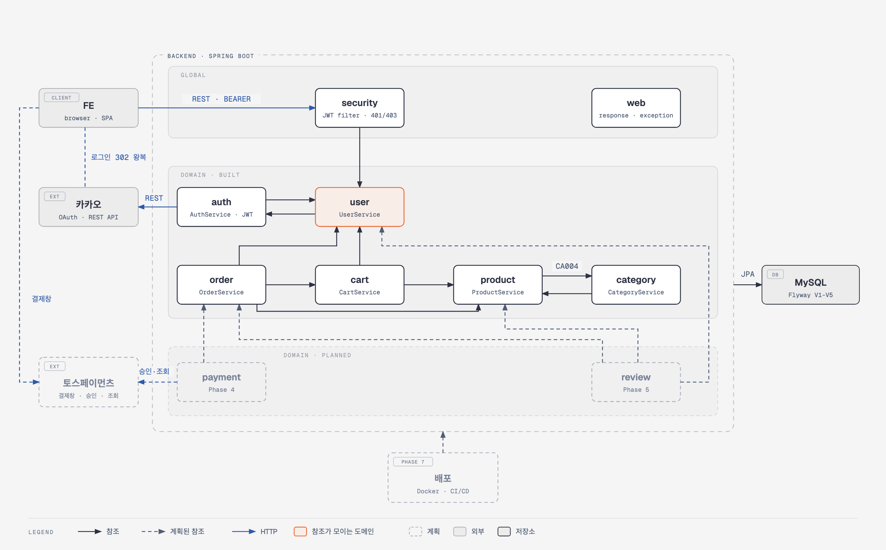
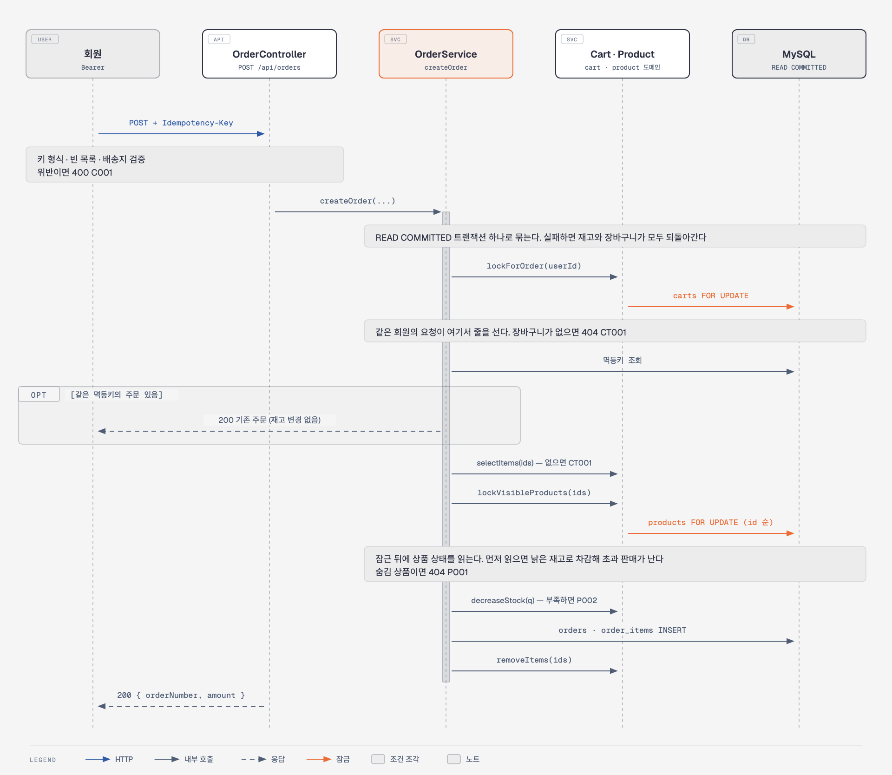
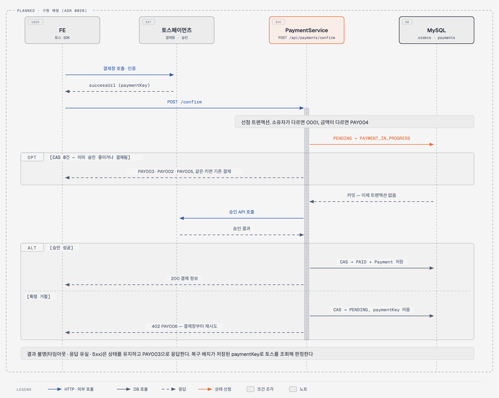
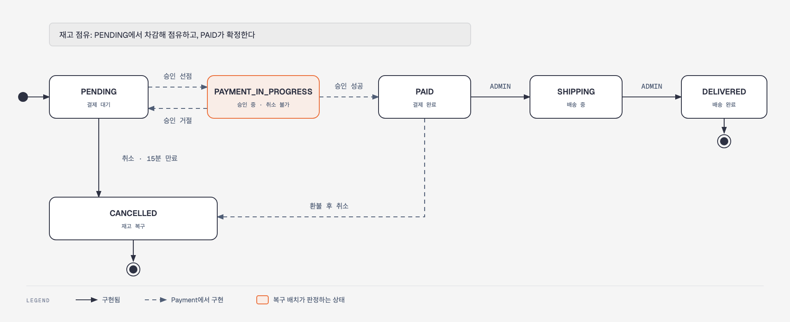

# ComeUs Backend

대용량 트래픽을 목표로 한 이커머스 백엔드입니다.
장바구니, 주문, 결제 과정에서 동시 요청에도 재고와 결제가 어긋나지 않도록 설계하고, 설계 선택을 측정치로 검증합니다.

## 기술 스택

| 구분 | 기술 |
|---|---|
| 언어·프레임워크 | Java 21, Spring Boot 3.5, Spring Security |
| 데이터 | MySQL 8, Spring Data JPA, Flyway |
| 인증 | 카카오 OAuth, JWT |
| 테스트 | JUnit 5, H2 |
| 결제 | 토스페이먼츠 (예정) |
| 배포 | Docker, docker-compose, CI/CD, Actuator (예정) |
| 부하 측정 | k6 또는 Gatling (예정) |
| 동시성 전환 후보 | 원자적 감소, Redis 분산 락, Redis 재고 게이트 (예정) |

## 전체 아키텍처

자세한 설명은 [시스템 구성도 문서](docs/diagrams/global/system-overview.md)에 있습니다.

도메인 구성: User, Auth, Category, Product, Cart, Order, Payment, Review

## 핵심 도메인 아키텍처: 주문 & 결제

### 주문 생성

동시 주문에서도 재고가 초과 판매되지 않도록 `carts` → `products` 순으로 잠그고, 같은 멱등키의 재요청에는 기존 주문을 돌려줍니다. ([설명](docs/diagrams/purchase/seq-order-create.md))

### 결제 승인 (설계, 구현 예정)

되돌릴 수 없는 토스 승인은 트랜잭션 밖에서 호출하고, 주문 상태 CAS로 한 번만 진입시킵니다. ([설명](docs/diagrams/purchase/seq-payment-confirm.md))

### 주문 상태

재고는 `PENDING`에서 점유하고, `CANCELLED`로 가는 모든 전이가 복구합니다. ([설명](docs/diagrams/purchase/state-order.md))

### 핵심 설계 결정

| 문제 | 해결 | 근거 |
|---|---|---|
| 재고 초과 판매 | 비관적 락을 기준선으로 시작하고 전환은 측정 후 판단 | [ADR 0025](docs/decisions/purchase/0025-pessimistic-lock-as-stock-concurrency-baseline.md) |
| 중복 주문 | 헤더 멱등키와 복합 유니크 | [ADR 0024](docs/decisions/purchase/0024-order-idempotency-key-in-header.md), [0027](docs/decisions/purchase/0027-idempotency-uk-violation-responds-conflict.md) |
| 중복 청구, 승인 후 장애 | 토스 호출을 트랜잭션 밖에 두고 상태 CAS와 복구 배치로 메움 | [ADR 0026](docs/decisions/purchase/0026-payment-confirm-outside-transaction.md) |
| 결제 안 된 주문의 재고 점유 | 15분 만료 배치 | [order.md](docs/domains/purchase/order.md) |

## 문서

| 문서 | 내용 |
|---|---|
| [로드맵](docs/roadmap.md) | 지금 어디까지 됐고 다음은 무엇인가 |
| [아키텍처](docs/architecture.md) | 패키지 구조, 의존 규칙, 인증 배선 |
| [도메인 계약](docs/domains/) | 도메인별 API와 규칙 |
| [개발 규약](docs/conventions/) | 응답 포맷, 에러 코드, git 규칙 |
| [결정 기록(ADR)](docs/decisions/) | 왜 그렇게 정했는가 |
| [배포](docs/deployment.md) | 배포 방식과 운영 설정 |
| [로컬 실행](docs/local-setup.md) | 로컬 환경 세팅과 실행 방법 |
| [문서 안내](docs/README.md) | 전체 문서 구조 |
