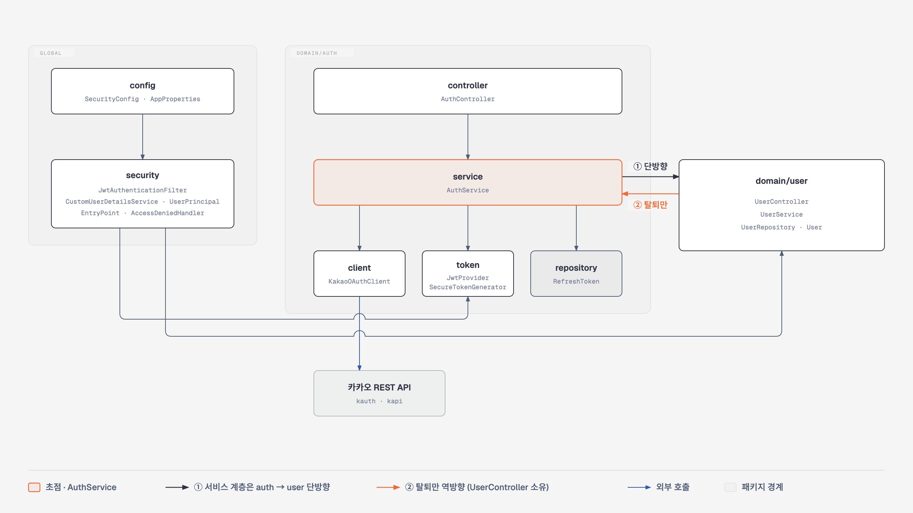
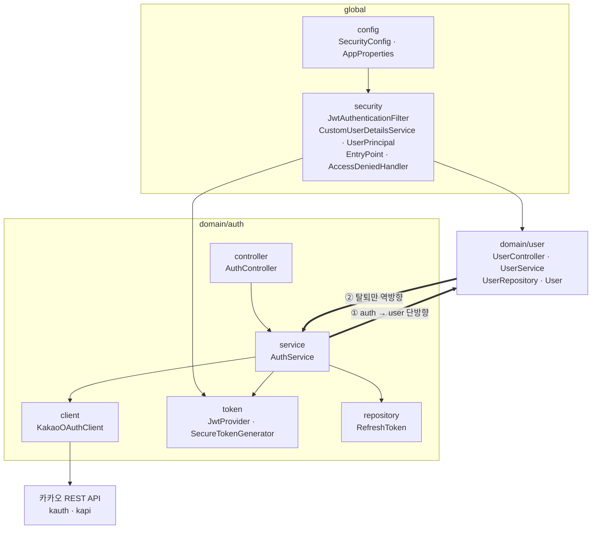
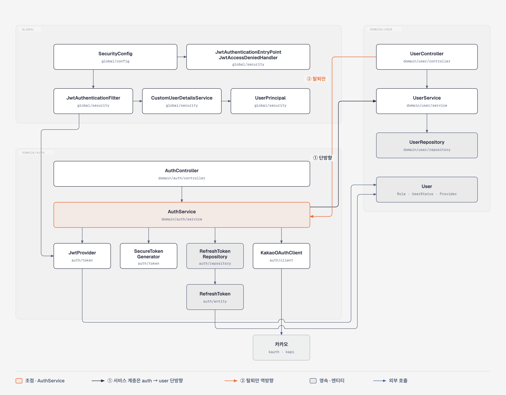
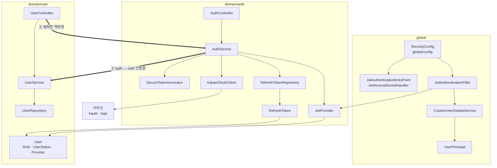

# OAuth · JWT 로그인 — 패키지 구조

- **답하는 질문**: 로그인에 참여하는 클래스가 어느 패키지에 있고, 패키지 사이 의존은 어느 방향으로만 흐르는가
- **범위**: 카카오 OAuth 왕복, JWT 발급·검증, 인증 필터. 상품·장바구니는 제외
- **원천**: [auth.md](../../domains/auth.md) · [architecture.md](../../architecture.md) · ADR [0002](../../decisions/auth/0002-backend-owns-redirect-uri.md) · [0005](../../decisions/auth/0005-opaque-refresh-token-hashed-in-db.md) · [0010](../../decisions/platform/0010-access-denied-handler-for-authorization.md)
- **흐름 그림**: [seq-auth-login.md](seq-auth-login.md)

Mermaid 원본 — PNG는 이 블록을 다시 그린 것이다 (배치는 <a href="../src/package-auth.html">src/package-auth.html</a>)

## 깨뜨리면 안 되는 규칙 4개

1. **① 서비스 계층의 의존은 `auth → user` 단방향이다.** `UserService`는 `AuthService`를 모른다 —
   회원 생성·재활성화 규칙이 user 한 곳에만 남게 하려는 것이다
2. **② 역방향은 탈퇴 하나뿐이고, 그 순서를 `UserController`가 소유한다.** user·auth를 함께 건드리는
   유일한 흐름인데, `UserService`가 `AuthService`를 참조하면 순환이 생긴다
3. **`domain/auth`에서 `UserRepository`로 가는 화살표는 없다** — 그림에 없는 것이 규칙이다.
   auth는 `UserService`의 공개 메서드만 경유한다. (`CustomUserDetailsService`가 `UserRepository`를
   직접 쓰는 건 예외가 아니다 — 그건 `global/security`이지 auth가 아니다)
4. **`global/security`는 어댑터만 둔다.** 토큰 생성·파싱은 `domain/auth/token`에 있고,
   security 패키지는 그걸 Spring Security의 `Filter`·`UserDetailsService`에 끼우는 일만 한다

## 클래스 단위 상세

위 그림은 패키지 사이의 의존 방향만 본다. 패키지 안에서 어떤 클래스가 무엇을 주입받는지는 이 그림이 기준이다.

Mermaid 원본 — PNG는 이 블록을 다시 그린 것이다 (배치는 <a href="../src/package-auth-internals.html">src/package-auth-internals.html</a>)

### 이 그림이 생략한 것

로그인 경로를 지탱하는 17개만 남겼다. 아래는 그림에 없지만 **실제로 존재하는 의존**이다.

| 생략한 것 | 실제 관계 |
|---|---|
| `JwtProperties` · `KakaoProperties` | `AuthService`·`JwtProvider`가 전자를, `AuthController`·`KakaoOAuthClient`가 후자를 읽는다 |
| `RestClientConfig` | `kauth`·`kapi`용 `RestClient` Bean 2개를 `KakaoOAuthClient`에 공급한다 |
| `CookieUtil` · `AppProperties` | `AuthController`·`UserController`가 함께 쓰고, `CookieUtil`은 `AppProperties`의 `cookie.secure`를 읽는다 |
| `KakaoUserResolution` | `UserService`가 만들고 `AuthService`가 받는 **두 도메인의 경계 DTO**다 |
| `KakaoTokenResponse` · `KakaoUserInfoResponse` | `KakaoOAuthClient` 안에서만 쓰인다 |
| `global/security` → `UserRepository` | `CustomUserDetailsService`가 매 요청 회원을 다시 읽는다 (개요 그림의 `security → domain/user`) |
| `BusinessException` · `ErrorCode` · `ApiResponse` | 모든 계층이 참조해서 그리면 그림이 선으로 덮인다 |

### 패키지가 그 자리에 있는 이유

| 패키지 | 왜 거기인가 |
|---|---|
| `global/security` | Spring Security 어댑터는 특정 도메인의 소유가 아니다. auth에 두면 user도 끌려 들어온다 |
| `global/util/CookieUtil` | `refresh_token`(auth)과 로그아웃·탈퇴 쿠키(user)를 **양쪽 컨트롤러가 함께 쓴다** |
| `global/config/AppProperties` | `SecurityConfig`(CORS)와 `AuthController`(FE 복귀 주소)가 공유한다 |
| `domain/auth/config/KakaoProperties` | 카카오는 auth만의 관심사다. `AuthController`·`KakaoOAuthClient`만 읽는다 |
| `domain/user/entity/Provider` | `User.provider`의 타입이라 user에 남는다 — auth로 옮기면 user가 auth를 의존한다 |

### 경계가 하나뿐인 지점

- **`KakaoOAuthClient`가 카카오로 나가는 유일한 문이다.** 이 클래스 밖에서는 카카오의 존재를 모르고,
  호출 실패는 여기서 전부 `BusinessException`(A005·A006)으로 바뀐다
- **`CookieUtil`이 쿠키 속성을 만드는 유일한 지점이다.** `SameSite`·`Path`가 하나만 어긋나도
  로그인 전체가 깨지므로 컨트롤러에 흩뿌리지 않는다
- **`JwtProvider`는 access token만, `SecureTokenGenerator`는 불투명 랜덤만** 담당한다.
  refresh token은 JWT가 아니라서 둘이 갈라진다 ([ADR 0005](../../decisions/auth/0005-opaque-refresh-token-hashed-in-db.md))
- **`AuthErrorCode`가 401·403 응답의 유일한 사유 출처다.** 필터는 코드를 request attribute에 적고
  `EntryPoint`/`AccessDeniedHandler`가 그걸 읽어 응답을 쓴다
  ([ADR 0010](../../decisions/platform/0010-access-denied-handler-for-authorization.md))
