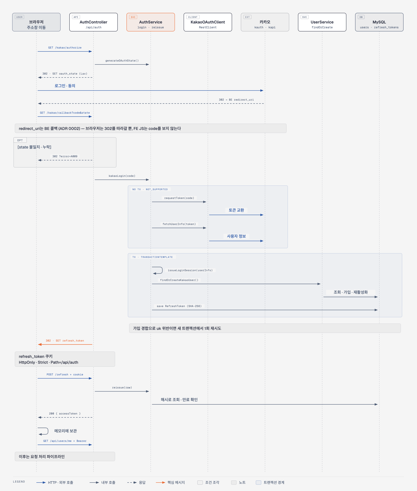
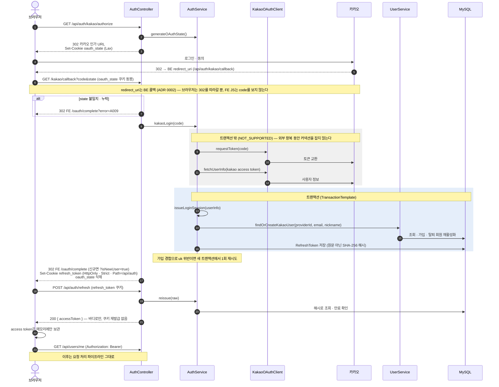

# 카카오 로그인 + silent refresh

- **답하는 질문**: 카카오 로그인부터 첫 API 호출까지 토큰이 어디서 만들어지고 어디에 실리는가
- **범위**: 인가 시작 → 콜백 → refresh 쿠키 발급 → access token 재발급 → 보호 API 호출. 로그아웃·탈퇴는 제외
- **원천**: [auth.md](../../domains/auth.md) · ADR [0002](../../decisions/auth/0002-backend-owns-redirect-uri.md) · [0004](../../decisions/auth/0004-no-refresh-token-rotation.md) · [0005](../../decisions/auth/0005-opaque-refresh-token-hashed-in-db.md) · [0006](../../decisions/auth/0006-cookie-samesite-and-path.md) · [0009](../../decisions/auth/0009-signup-race-retry-at-login-boundary.md)

Mermaid 원본 — 내용은 이 블록이 기준이고 PNG는 여기서 다시 그린다

## 읽는 법

- **콜백은 어떤 실패에도 JSON을 내지 않는다** — 브라우저 주소창에 응답이 그대로 보이므로 모든 실패가 `?error=<코드>` 302다
- `oauth_state`는 `Lax`여야 한다. 카카오 → API 서버 이동이 cross-site 네비게이션이라 `Strict`이면 쿠키가 실리지 않는다
- `refresh_token`은 `Strict`라 CSRF 토큰 없이도 안전하고, 그 대가로 **FE·BE가 같은 상위 도메인에 있어야** 한다([deployment.md](../../deployment.md))
- 재발급은 access token만 새로 만든다. refresh token은 돌려쓰지 않는다(rotation 미적용, ADR 0004)
