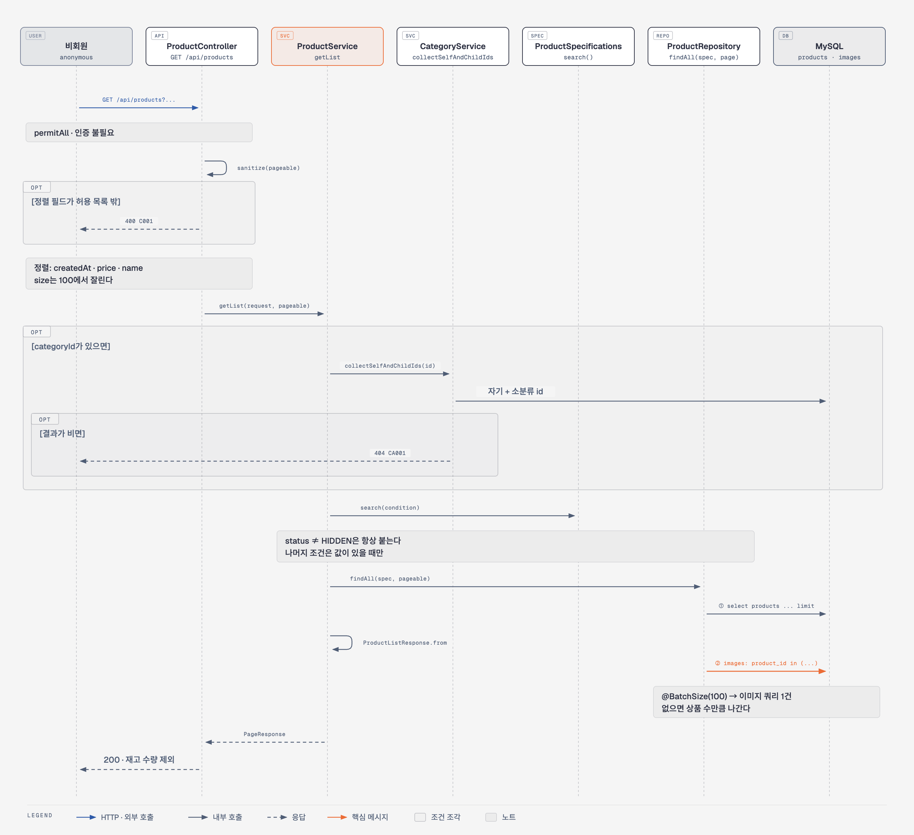
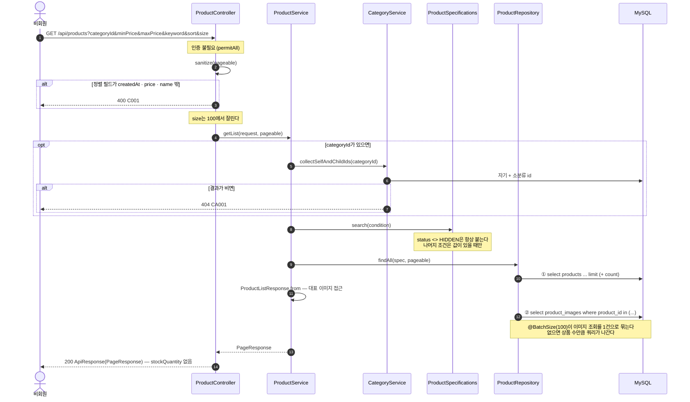

# 상품 목록 조회

- **답하는 질문**: 비회원 목록 조회가 필터·정렬·페이징을 어떻게 SQL로 바꾸고, 이미지 N+1을 어떻게 피하는가
- **범위**: `GET /api/products` 한 건. 상세 조회·쓰기는 제외
- **원천**: [product.md](../../domains/catalog/product.md) · ADR [0011](../../decisions/catalog/0011-jpa-specification-for-product-filter.md) · [0012](../../decisions/catalog/0012-image-urls-in-separate-table.md) · [0013](../../decisions/catalog/0013-hide-soft-deleted-products-everywhere.md) · [0015](../../decisions/catalog/0015-no-stock-quantity-in-public-response.md)

Mermaid 원본 — 내용은 이 블록이 기준이고 PNG는 여기서 다시 그린다

## 읽는 법

- 대분류를 고르면 소분류 상품까지 나온다. 카테고리가 2depth로 고정이라 재귀 없이 쿼리 한 번으로 id를 모은다
- 카테고리가 없으면 빈 목록이 아니라 404다 — 자기 id가 항상 결과에 들어가므로 빈 결과가 곧 "없는 카테고리"다
- `HIDDEN`(soft delete)은 목록·상세·장바구니 어디서나 보이지 않는다(ADR 0013)
- `@BatchSize`를 페이지 상한과 같은 100으로 맞춰서, 어느 페이지든 이미지 쿼리가 1건이다
- 2026-09-26 MySQL 실기동에서 상품 5건 조회에 쿼리 2건이 나가는 것을 확인했다(첫 페이지가 다 차지 않으면 Spring Data가 count 쿼리를 생략한다)
