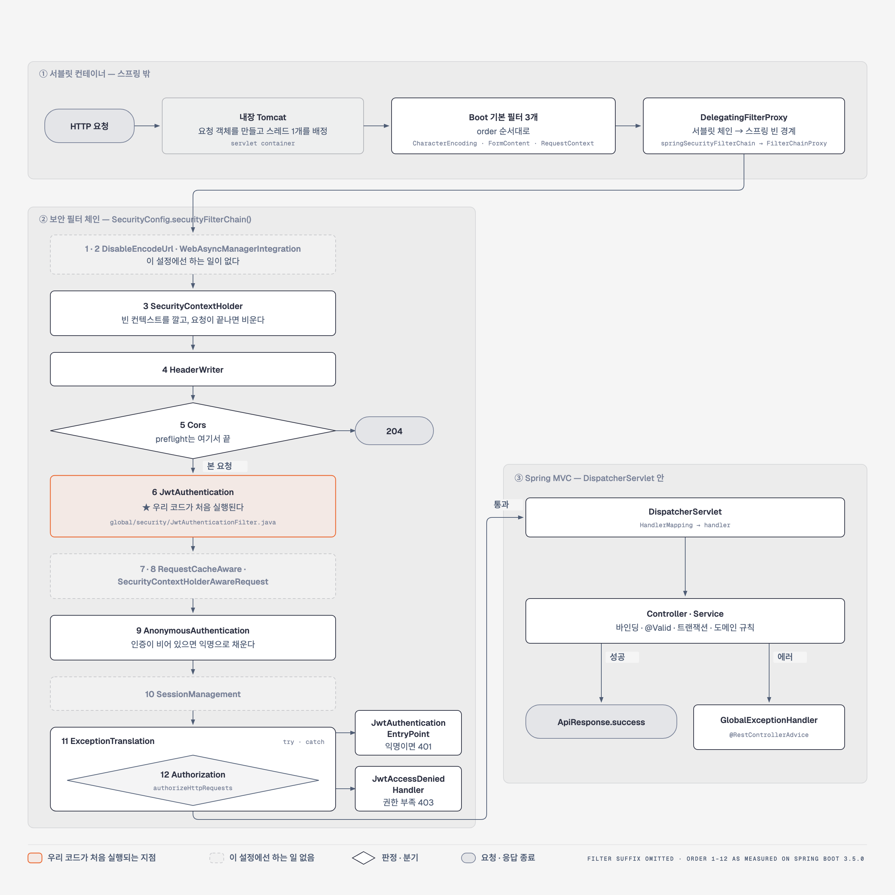
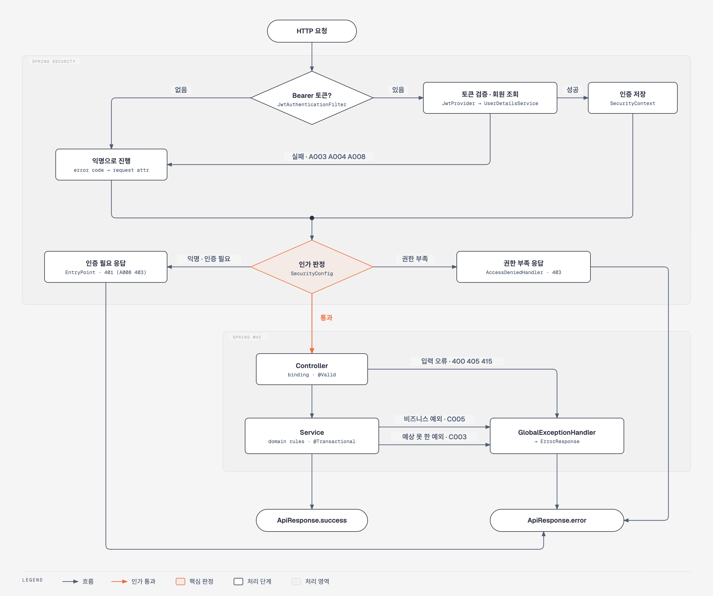

# 요청 처리 파이프라인

- **답하는 질문**: 요청 하나가 어떤 단계를 거쳐 성공 응답 또는 에러 응답이 되는가
- **범위**: 서블릿 컨테이너 → 보안 필터 체인 → 컨트롤러(바인딩·검증) → 서비스 → 응답.
  카카오 콜백은 JSON 대신 302로 응답해 예외다 — [카카오 로그인](../auth/seq-auth-login.md)
- **원천**: [api-response.md](../../conventions/api-response.md)(에러 코드·예외 매핑 표) · [architecture.md](../../architecture.md) "인증 · 인가" · ADR [0010](../../decisions/platform/0010-access-denied-handler-for-authorization.md)

## 1. 요청이 거치는 네 겹 — 프레임워크가 깔아 둔 길

요청을 처음 받는 것은 우리 클래스가 아니라 내장 Tomcat이고, 우리 코드는 보안 필터 체인의 여섯 번째에서 시작한다.

| 겹 | 클래스 | 하는 일 |
|---|---|---|
| 서블릿 컨테이너 | 내장 Tomcat | HTTP를 요청 객체로 만들고 스레드 하나를 배정한다. 이 요청은 끝까지 그 스레드에서 처리된다 |
| | `CharacterEncoding` | 요청 본문·파라미터를 UTF-8로 읽도록 강제한다. 설정이 없어 Boot 기본값(UTF-8, 요청만 강제)을 쓴다 |
| | `FormContent` | `PUT`·`PATCH`·`DELETE`의 폼 본문을 파싱해 `getParameter()`로 읽히게 한다. 서블릿 규격은 `POST`만 해 준다 — 이 프로젝트는 JSON만 받아 실제로 하는 일이 없다 |
| | `RequestContext` | 현재 요청을 스레드에 묶어(`RequestContextHolder`) MVC 밖에서도 요청·로케일을 꺼낼 수 있게 한다 |
| | `DelegatingFilterProxy` | 서블릿 체인에서 스프링 빈(`FilterChainProxy`)으로 넘어가는 경계 |
| 보안 필터 체인 | 1 `DisableEncodeUrl` · 2 `WebAsyncManagerIntegration` | 이 설정에선 하는 일이 없다 |
| | 3 `SecurityContextHolder` | 빈 컨텍스트를 깔고, 요청이 끝나면 비운다 |
| | 4 `HeaderWriter` | 보안 헤더를 붙인다 |
| | 5 `Cors` | preflight(`OPTIONS`)를 여기서 204로 끝낸다 — 토큰 검사까지 가지 않는다 |
| | **6 `JwtAuthentication`** | **우리 코드가 처음 실행되는 지점** |
| | 7 `RequestCacheAware` · 8 `SecurityContextHolderAwareRequest` | 이 설정에선 하는 일이 없다 |
| | 9 `AnonymousAuthentication` | 인증이 비어 있으면 익명 토큰을 채운다 |
| | 10 `SessionManagement` | `STATELESS`라 하는 일이 없다 |
| | 11 `ExceptionTranslation` | 12를 `try·catch`로 감싸 인가 거절을 401·403 응답으로 바꾼다 |
| | 12 `Authorization` | `SecurityConfig`의 `authorizeHttpRequests` 규칙으로 판정한다 |
| Spring MVC | `DispatcherServlet` | 핸들러를 찾아 컨트롤러로 보낸다. `@RestControllerAdvice`는 여기 안에서만 동작한다 |

> 필터 이름의 `Filter` 접미사는 생략했다. 12개와 그 순서는 Spring Boot 3.5.0에서
> `FilterChainProxy.getFilterChains()`를 찍어 확인한 값이다 —
> 버전을 올리면 `logging.level.org.springframework.security: DEBUG`로 다시 확인한다.

## 2. 우리 코드가 하는 일 — 판정과 응답 계약

| 단계 | 클래스 | 하는 일 |
|---|---|---|
| 인증 | `JwtAuthenticationFilter` | `Bearer` 토큰을 읽어 `JwtProvider`로 검증하고, `CustomUserDetailsService`가 **매 요청 DB에서** 회원·role을 읽어 `SecurityContext`에 담는다. 실패해도 응답을 쓰지 않고 컨텍스트를 비운 뒤 에러 코드만 요청 속성에 남긴다 |
| | `JwtProvider` | 서명·만료 검증, subject(회원 id) 추출 |
| | `CustomUserDetailsService` | 회원 조회. role이 토큰이 아닌 DB에 있어 권한 변경·탈퇴가 다음 요청부터 반영된다 |
| 인가 | `SecurityConfig` | permitAll(로그인 왕복, 카테고리·상품 `GET`) · ADMIN(카테고리·상품 쓰기) · 그 외 authenticated |
| | `JwtAuthenticationEntryPoint` | 익명인데 인증이 필요하면 기록된 코드로, 없으면 A001로 응답 (대부분 401, 탈퇴 A008만 403) |
| | `JwtAccessDeniedHandler` | 인증됐지만 권한이 부족하면 403 A002 |
| 검증 | `Controller` | 바인딩·`@Valid`. 실패 400(C001), 메서드 405, Content-Type 415(C006) |
| 규칙 | `Service` | 도메인 규칙 위반은 `BusinessException(ErrorCode)`. DB 유니크 제약 위반은 C005(409) |
| 응답 | `GlobalExceptionHandler` | 예외를 `ErrorCode`로 골라 `ApiResponse.error(ErrorResponse)`로 감싼다. 걸리지 않은 예외는 500 C003 |
| | `ApiResponse` · `PageResponse` | 성공 응답. 목록은 `data`가 `PageResponse` |

필터가 기록하는 인증 실패 코드.

| 실패 원인 | 코드 |
|---|---|
| 만료 (`ExpiredJwtException`) | A004 |
| 서명·형식 오류 (`JwtException`) | A003 |
| 탈퇴 회원 (`DisabledException`) | A008 |
| 회원 없음 · subject 형식 오류 | A001 |

401·403은 `DispatcherServlet` 밖에서 만들어져 `GlobalExceptionHandler`를 거치지 않지만, 클라이언트가 받는 형식은 같다.
예외별 정확한 매핑은 [api-response.md](../../conventions/api-response.md)의 표가 소유한다.
