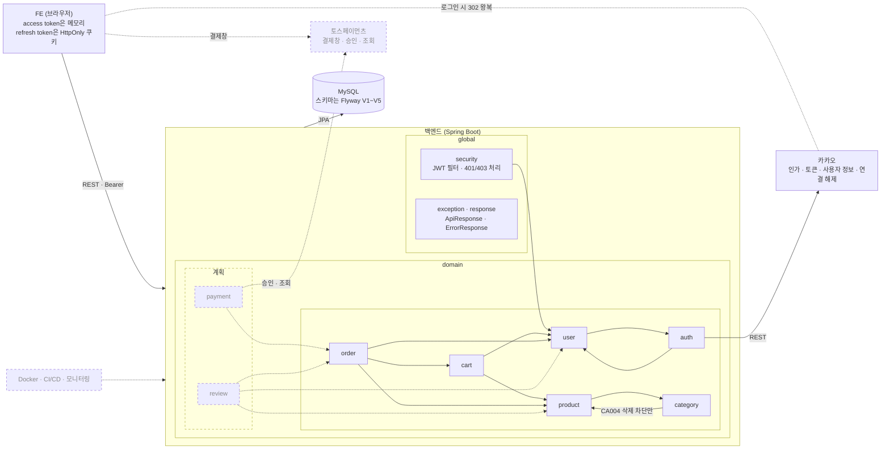

# 시스템 구성도

- **답하는 질문**: 시스템은 무엇과 통신하고, 안에 어떤 도메인이 있는가
- **범위**: 외부 시스템 · 도메인 · 도메인 간 참조. 클래스 수준은 [요청 처리 파이프라인](request-pipeline.md)과 시퀀스가 맡는다
- **원천**: [architecture.md](../../architecture.md) "의존 규칙" · [deployment.md](../../deployment.md) · ADR [0001](../../decisions/auth/0001-kakao-only-oauth.md) · [0008](../../decisions/platform/0008-flyway-owns-schema.md) · [0014](../../decisions/catalog/0014-category-reads-product-repository.md)

Mermaid 원본 — 내용은 이 블록이 기준이고 PNG는 여기서 다시 그린다

## 읽는 법

- **화살표는 "참조한다"**다. 모든 도메인 간 참조는 상대 Service를 거친다. 예외는 `category → product` 하나로,
  Service를 거치면 생성자 주입이 순환해 `ProductRepository`를 직접 읽는다
- `auth ↔ user`가 양방향인 것은 의도다 — 로그인은 회원을 찾거나 만들고(`auth → user`),
  탈퇴는 토큰 폐기와 카카오 연결 해제까지 끝내야 한다(`user → auth`)
- `security → user`는 JWT 필터가 **매 요청 DB에서 회원과 role을 읽기** 때문이다. 권한이 토큰 claim에 들어 있지 않다
- 점선은 Phase 4 Payment·토스페이먼츠, Phase 5 Review, Phase 7 배포다. 참조 방향은 architecture.md에 미리 정해 둔 것이다
