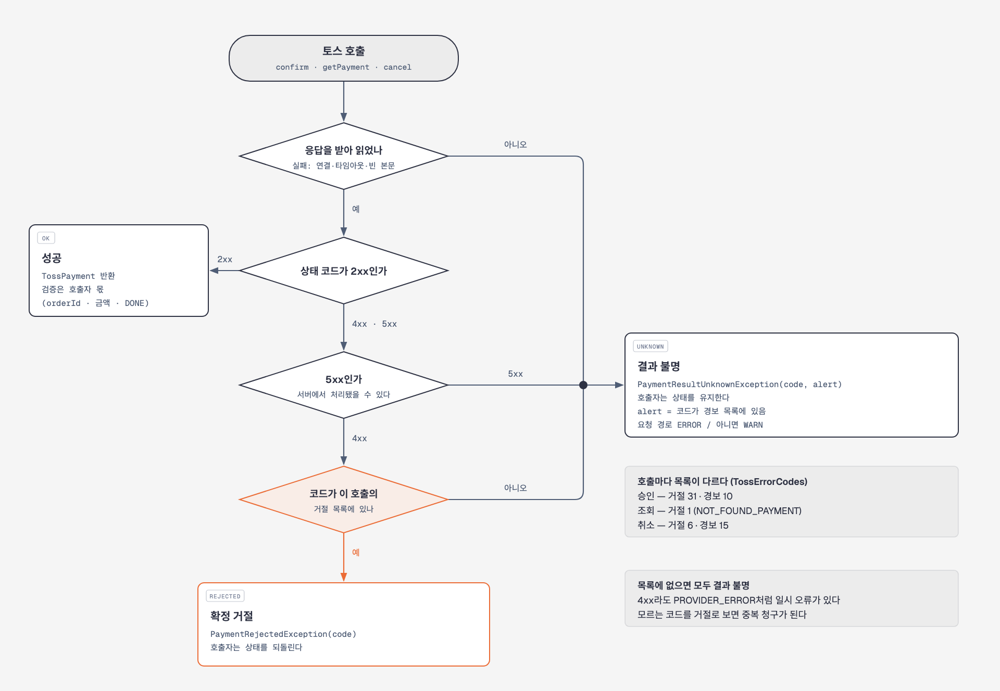
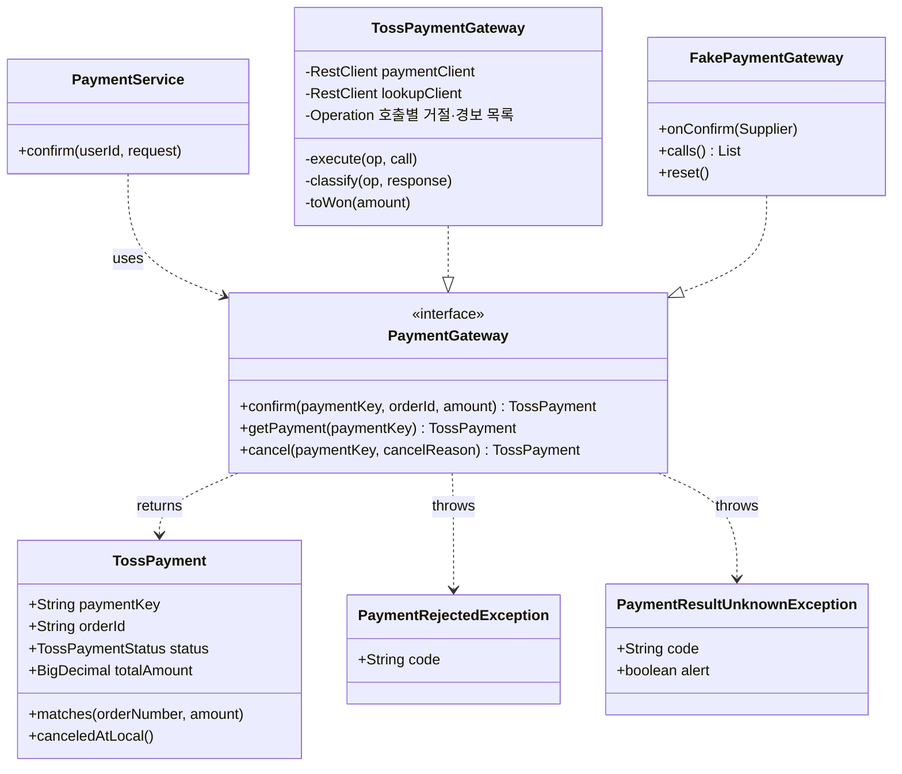

# 5. 결제 게이트웨이

> **토스와 통신하는 유일한 창구다. 서비스는 인터페이스와 예외 두 개만 알고, 확인된 코드만 확정 거절이며 나머지는 모두 결과 불명이다.**

| | |
|---|---|
| 답하는 질문 | 서비스는 토스를 어디까지 알고, 토스 응답 하나는 어떻게 성공 · 확정 거절 · 결과 불명 중 하나가 되는가 |
| 범위 | `PaymentGateway`와 토스 구현. 주문 상태 변경은 호출자 몫이다 — [4. 승인](seq-payment-confirm.md) · [6. 환불](seq-refund.md) · [7. 복구 배치](seq-payment-recovery.md) |
| 근거 | [payment.md](../../domains/purchase/payment.md)의 "토스 연동" · ADR [0028](../../decisions/purchase/0028-payment-result-whitelist-and-recovery-limit.md) · [0029](../../decisions/purchase/0029-refund-outside-transaction.md) · [0030](../../decisions/purchase/0030-recovery-batch-runtime-limits.md) |

그림은 두 장이다. **구조**가 "누가 무엇을 아는가"를, **판정 흐름**이 "응답이 어떻게 갈리는가"를 보여준다.

## 그림 1. 구조

- 승인(`PaymentService`) · 환불(`RefundService`) · 복구 배치(`PaymentRecoveryService`)가 모두 `PaymentGateway`의 메서드 세 개(`confirm` · `getPayment` · `cancel`)만 부른다
- 인증 헤더, 멱등키 규칙, 토스 에러 코드는 `TossPaymentGateway`만 안다. 코드 목록(`TossErrorCodes`)은 package-private이라 서비스에서 컴파일조차 안 된다
- 테스트는 `FakePaymentGateway`로 거절 · 타임아웃 같은 상황을 토스 없이 만든다

| 호출자가 받는 것 | 뜻 | 호출자의 처리 |
|---|---|---|
| `TossPayment` | 토스가 처리했다 | `orderId` · 금액 · `status`를 주문과 대조한 뒤 반영(`matches`) |
| `PaymentRejectedException` | 처리하지 않았다고 **확인됨** | 상태를 되돌린다 |
| `PaymentResultUnknownException` | 처리됐는지 **모름** | 상태를 유지하고 복구 배치에 맡긴다. `alert`면 경보 대상 |

두 예외를 하나로 합치지 않는 것이 핵심이다. 합치면 "실패했으니 되돌린다"밖에 할 수 없고, 결과 불명 주문을 되돌리면 재결제가 **중복 청구**가 된다.

## 그림 2. 판정 흐름

확정 거절에 닿는 길은 **네 질문을 모두 통과한 한 갈래**뿐이다.

1. **응답을 받아 읽었나** (`execute`) — 타임아웃 · 연결 실패 · 역직렬화 실패 · 빈 본문이면 결과 불명
2. **2xx인가** — 2xx면 `TossPayment`. 성공도 바로 믿지 않고 호출자가 `matches`로 검증한다
3. **5xx인가** (`classify`) — 5xx는 코드와 무관하게 결과 불명. 토스 쪽에서 처리됐을 수 있다
4. **코드가 이 호출의 거절 목록에 있나** — 있으면 확정 거절, 없거나 본문을 못 읽으면 결과 불명

| 호출 | 확정 거절 | 결과 불명 + 경보 |
|---|---|---|
| 승인 | 31개 — 카드·계좌 거절, 한도, 할부·수단 불가, 세션 없음 | 10개 — 키·인증·요청 형식 오류, `DUPLICATED_ORDER_ID` |
| 조회 | `NOT_FOUND_PAYMENT` 1개 | 없음 |
| 취소 | 6개 — `REFUND_REJECTED` 등 | 15개 — 설정 오류, 쓰지 않는 기능의 코드 |

같은 코드도 호출마다 뜻이 다르다. `NOT_FOUND_PAYMENT`는 승인·조회에선 거절이지만, 결제가 있던 주문을 취소할 때 나오면 우리 쪽 오류라 경보다.

## 지키는 것

| 불변식 | 깨지면 | 장치 |
|---|---|---|
| 실패는 반드시 두 예외 중 하나 | 처음 보는 예외로 상태를 잘못 되돌림 | `execute`가 통신 실패를, `classify`가 에러 응답을 둘로 바꾼다 |
| 모르는 것은 "모른다"로 분류 | 처리됐을 수 있는 결제를 되돌려 중복 청구 | 화이트리스트 — 확인된 코드만 거절 |
| 같은 시도의 재호출은 같은 멱등키 | 재호출이 새 요청이 된다 | 승인 `{paymentKey}`, 취소 `cancel-{paymentKey}` — Gateway가 만든다 |
| 다른 주문의 결제로 승인되지 않는다 | 100원 결제로 10만 원 주문이 `PAID` | `TossPayment.matches` — 호출자가 반영 전에 검증 |

**왜 화이트리스트인가** — 결과 불명을 거절로 보면 중복 청구(큰 비용), 거절을 결과 불명으로 보면 5분 늦게 재시도(작은 비용)다. 기본값을 비용이 작은 쪽에 둔다. 토스가 코드를 추가해도 안전한 쪽으로 떨어진다.

| 클라이언트 | 쓰는 곳 | 연결 · 읽기 | 이유 |
|---|---|---|---|
| `tossRestClient` | 승인 · 취소 | 3초 · 30초 | 돈이 움직인다. 일찍 끊으면 결과 불명이 는다 |
| `tossLookupRestClient` | 조회 (복구 배치) | 3초 · 5초 | 실패해도 다음 주기에 다시 한다. 배치 예산을 오래 붙잡지 않는다 |

`alert`는 표시만 한다. 로그 레벨은 호출 경로가 정한다 — 요청 경로는 ERROR, 복구 배치는 WARN(1분마다 같은 주문을 다시 보므로).

## 코드 위치

| 요소 | 코드 |
|---|---|
| 경계 | `domain/payment/gateway/PaymentGateway` · `TossPayment` · `TossPaymentStatus` |
| 구현 · 판정 | `gateway/toss/TossPaymentGateway` — `execute`, `classify`, `readError` |
| 코드 목록 | `gateway/toss/TossErrorCodes` |
| HTTP 설정 | `gateway/toss/TossRestClientConfig` · `TossProperties` |
| 예외 | `exception/PaymentRejectedException` · `PaymentResultUnknownException` |
| 테스트 | `TossPaymentGatewayTest`(판정) · `FakePaymentGateway`(서비스 테스트용 대역) |

Mermaid 원본 — 그림 1. 구조

Mermaid 원본 — 그림 2. 판정 흐름

---

[← 이전: 4. 결제 승인](seq-payment-confirm.md) · [목차](README.md) · [다음: 6. 환불 →](seq-refund.md)
