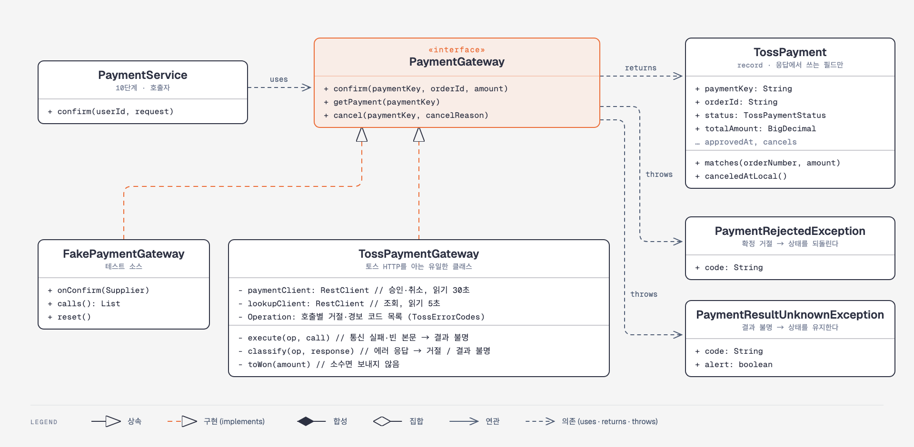
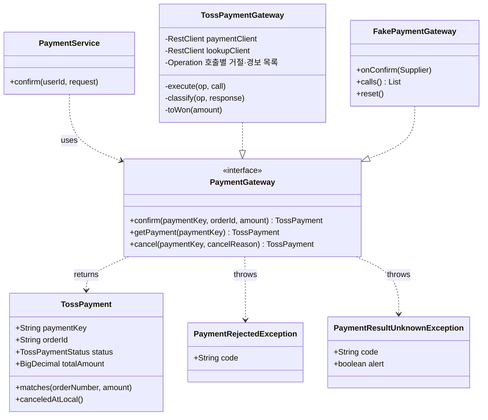
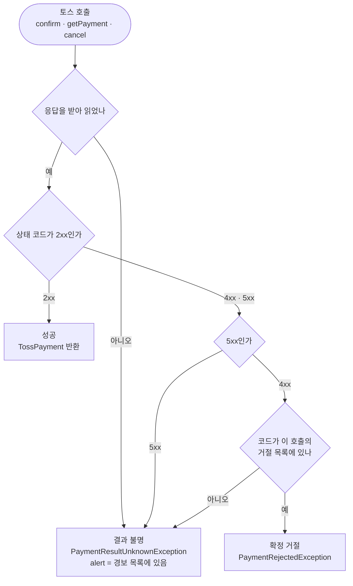

# 결제 게이트웨이

> 이 그림은 Phase 4 · 9단계에서 구현한 토스 연동 경계다. 설계 근거는 [ADR 0028](../../decisions/purchase/0028-payment-result-whitelist-and-recovery-limit.md)·[0029](../../decisions/purchase/0029-refund-outside-transaction.md)·[0030](../../decisions/purchase/0030-recovery-batch-runtime-limits.md), 구현 진행은 [roadmap.md](../../roadmap.md)가 소유한다.

- **답하는 질문**: 서비스는 토스를 어디까지 알고, 토스 응답 하나는 어떻게 성공 · 확정 거절 · 결과 불명 셋 중 하나가 되는가
- **범위**: `PaymentGateway`와 그 구현. 주문 상태 변경은 호출자 몫이라 [결제 승인](seq-payment-confirm.md) · [복구 배치](seq-payment-recovery.md)가 다룬다
- **원천**: [payment.md](../../domains/purchase/payment.md)의 "토스 연동" · `TossPaymentGateway` · `TossErrorCodes`

그림은 두 장이다. **구조**가 "누가 무엇을 아는가"를, **판정 흐름**이 "응답이 어떻게 갈리는가"를 보여준다.

## 1. 구조 — 서비스는 인터페이스와 예외 두 개만 안다

Mermaid 원본 — 내용은 이 블록이 기준이고 PNG는 여기서 다시 그린다

### 그림 따라 읽기

**① 왼쪽 위 — `PaymentService`는 인터페이스에만 의존한다**
- 서비스가 아는 것은 `PaymentGateway`의 메서드 세 개와, 돌아오는 `TossPayment`, 던져지는 예외 두 개뿐이다
- URL, 인증 헤더, 멱등키 규칙, 토스 에러 코드는 모른다. 11단계 복구 배치와 12단계 환불도 같은 인터페이스를 쓴다

**② 가운데 — `PaymentGateway`가 경계다** (강조색)
- 성공하면 `TossPayment`를 돌려주고, 실패하면 **반드시 두 예외 중 하나**를 던진다
- 경계의 책임은 "토스와 한 번 통신하고 결과를 해석하는 것"까지다. 주문 상태 변경, 저장, 재시도는 하지 않는다

**③ 아래 — 구현이 둘이다**
- `TossPaymentGateway`는 토스 HTTP를 아는 유일한 클래스다
  - `RestClient` 두 개: 승인 · 취소는 읽기 30초, 조회는 읽기 5초. 돈이 움직이는 호출을 짧게 끊으면 결과 불명이 늘고, 조회는 복구 배치를 오래 붙잡으면 안 된다
  - `execute`와 `classify`가 실패를 두 예외로 나눈다. 과정은 아래 2번 그림이다
  - `toWon`은 금액을 정수 원으로 바꾼다. 소수가 있으면 토스를 부르지 않는다
- `FakePaymentGateway`는 테스트 소스에 있다. 서비스 테스트가 "거절", "타임아웃", "호출 중 다른 경로가 먼저 반영" 같은 상황을 토스 없이 만든다. 게이트웨이를 인터페이스로 둔 이유 중 하나다

**④ 오른쪽 — 호출자가 받는 것**

| 받는 것 | 뜻 | 호출자의 처리 |
|---|---|---|
| `TossPayment` | 토스가 처리했다 | `orderId` · 금액 · `status`를 주문과 대조한 뒤 반영 (`matches`) |
| `PaymentRejectedException` | 토스가 처리하지 않았다고 **확인됨** | 상태를 되돌린다 |
| `PaymentResultUnknownException` | 처리됐는지 **모름** | 상태를 유지하고 복구 배치에 맡긴다. `alert`면 경보 대상 |

`TossPayment`는 토스 Payment 객체 중 쓰는 필드만 담는다. 필드별 용도와 저장 위치는 [payment.md](../../domains/purchase/payment.md)의 "응답을 `TossPayment`로 바꾼다" 표가 기준이다.

## 2. 판정 흐름 — 목록에 있는 코드만 거절이다

Mermaid 원본 — 내용은 이 블록이 기준이고 PNG는 여기서 다시 그린다

### 그림 따라 읽기

위에서 아래로 질문 네 개를 차례로 묻는다. 확정 거절에 닿는 길은 **네 질문을 모두 통과한 한 갈래**뿐이고, 나머지는 성공 아니면 결과 불명이다.

**① 응답을 받아 읽었나** — `execute`
- 연결 실패, 타임아웃, 응답 역직렬화 실패, 2xx인데 본문이 없는 경우가 "아니오"다
- 요청이 토스에 닿았는지조차 모르므로 결과 불명이다. 코드가 없어 `alert`는 false다

**② 상태 코드가 2xx인가**
- 2xx면 본문을 `TossPayment`로 돌려준다
- 성공이라도 바로 믿지 않는다. `orderId` · 금액 · `status` 검증은 호출자가 `matches`로 한다. 다른 주문의 `paymentKey`로 승인을 받아 오는 것을 막기 위해서다

**③ 5xx인가** — 여기부터 `classify`
- 5xx는 **코드와 무관하게** 결과 불명이다. 토스 서버 쪽에서 처리를 마친 뒤 실패했을 수 있다

**④ 코드가 이 호출의 거절 목록에 있나** (강조색)
- 에러 본문 `{ code, message }`의 `code`를 호출별 목록(`TossErrorCodes`)과 대조한다. 본문을 해석할 수 없으면 코드가 없어 "아니오"다
- 목록은 호출마다 다르다 — 승인 거절 31개, 조회 거절 1개(`NOT_FOUND_PAYMENT`), 취소 거절 6개
  - 같은 코드도 뜻이 다르다. `NOT_FOUND_PAYMENT`는 승인 · 조회에선 거절이지만 취소에선 경보다
- **"4xx면 거절"이 아니다.** `PROVIDER_ERROR`처럼 400인데 일시 오류인 코드가 있다. 모르는 코드를 거절로 보면 승인된 결제를 되돌려 재시도가 중복 청구가 된다. 토스가 코드를 새로 추가해도 목록에 없으니 안전한 쪽(결과 불명)으로 떨어진다

**결과 불명의 `alert`**
- 코드가 그 호출의 경보 목록(승인 10개, 취소 15개)에 있으면 `alert = true`다. 키 설정 오류, 쓰지 않는 기능의 코드처럼 사람이 봐야 하는 경우다
- 게이트웨이는 표시만 한다. 로그 레벨은 호출 경로가 정한다 — 요청 경로는 ERROR, 복구 판정 중에는 WARN([ADR 0030](../../decisions/purchase/0030-recovery-batch-runtime-limits.md))

## 코드 위치

| 그림의 요소 | 코드 |
|---|---|
| 경계 | `domain/payment/gateway/PaymentGateway` |
| 구현 · 판정 | `gateway/toss/TossPaymentGateway` — `execute`, `classify`, `readError` |
| 코드 목록 | `gateway/toss/TossErrorCodes` |
| HTTP 설정 | `gateway/toss/TossRestClientConfig` |
| 예외 | `exception/PaymentRejectedException`, `exception/PaymentResultUnknownException` |
| 테스트 | `TossPaymentGatewayTest`(판정), `FakePaymentGateway`(서비스 테스트용 대역) |
