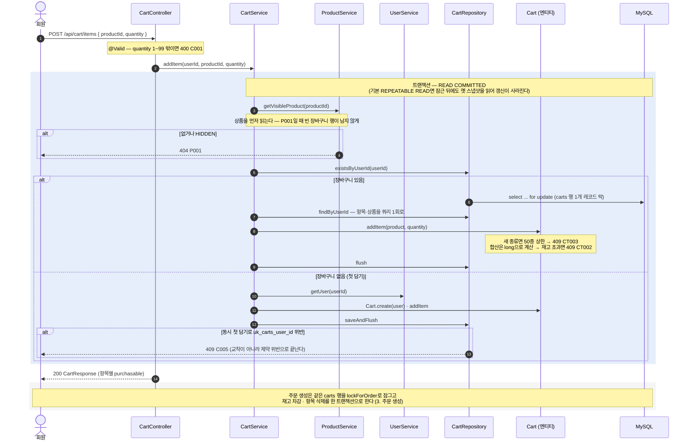

# 2. 장바구니 담기

> **`carts` 행 하나를 잠가 같은 회원의 동시 담기를 줄 세운다. 장바구니는 재고를 점유하지 않는다.**

| | |
|---|---|
| 답하는 질문 | 동시 담기에서 수량이 사라지지 않고, 첫 담기 경합이 왜 409가 되는가 |
| 범위 | `POST /api/cart/items` 한 건. 주문이 장바구니를 잠그고 비우는 부분은 [3. 주문 생성](seq-order-create.md) |
| 근거 | [cart.md](../../domains/purchase/cart.md) · ADR [0016](../../decisions/purchase/0016-stock-reserved-at-order-not-cart.md) · [0019](../../decisions/purchase/0019-cart-owns-item-deletion.md) · [0020](../../decisions/purchase/0020-cart-writes-use-read-committed.md) |

## 핵심 흐름

1. **상품을 먼저 읽는다** — 없거나 숨김이면 `P001`. 장바구니를 만들기 전에 거르므로 빈 장바구니 행이 남지 않는다
2. **장바구니가 있으면 잠근다** — `existsByUserId`로 확인한 뒤 `carts` 행 하나만 `FOR UPDATE`
3. **애그리거트가 담는다** — `Cart.addItem`이 50종 상한(`CT003`)과 재고 초과(`CT002`)를 판정한다
4. **첫 담기면 잠그지 않고 만든다** — 동시 첫 담기는 `uk_carts_user_id`가 막고 `C005`(409)로 끝난다

## 지키는 것

| 규칙 | 깨지면 | 장치 |
|---|---|---|
| 같은 회원의 동시 담기가 수량을 잃지 않는다 | 두 요청이 같은 수량을 읽고 덮어쓴다 | `carts` 루트 락 + READ COMMITTED (잠근 뒤 최신 값을 읽는다) |
| 없는 행에 락을 걸지 않는다 | gap lock끼리 교착 | 존재 확인 후에만 `FOR UPDATE`, 없으면 uk가 경합을 막는다 |
| 담기는 재고를 점유하지 않는다 | 담아 두고 사지 않는 사용자가 재고를 묶는다 | 재고는 보기만 하고 차감은 주문이 한다(ADR 0016). 재고가 줄면 `purchasable`만 `false` |

- 격리 수준은 `CartService`가 트랜잭션을 **새로 열 때만** 적용된다. 바깥 트랜잭션에 합류하면 Spring이 무시하므로, 주문 생성은 격리 수준 검증(`validateExistingTransaction`)을 켠 채 합류한다
- 수량 변경·항목 삭제·비우기도 같은 락 경로(`findLockedCart`)를 탄다

## 코드 위치

| 단계 | 코드 |
|---|---|
| 진입 | `CartController.addItem` → `CartService.addItem` |
| 잠금 | `CartService.findLockedCart` → `CartRepository.existsByUserId` · `lockByUserId` · `findByUserId` |
| 판정 | `Cart.addItem` |

Mermaid 원본 — 내용은 이 블록이 기준이고 PNG는 여기서 다시 그린다

---

[← 이전: 1. 주문 상태](state-order.md) · [목차](README.md) · [다음: 3. 주문 생성 →](seq-order-create.md)
