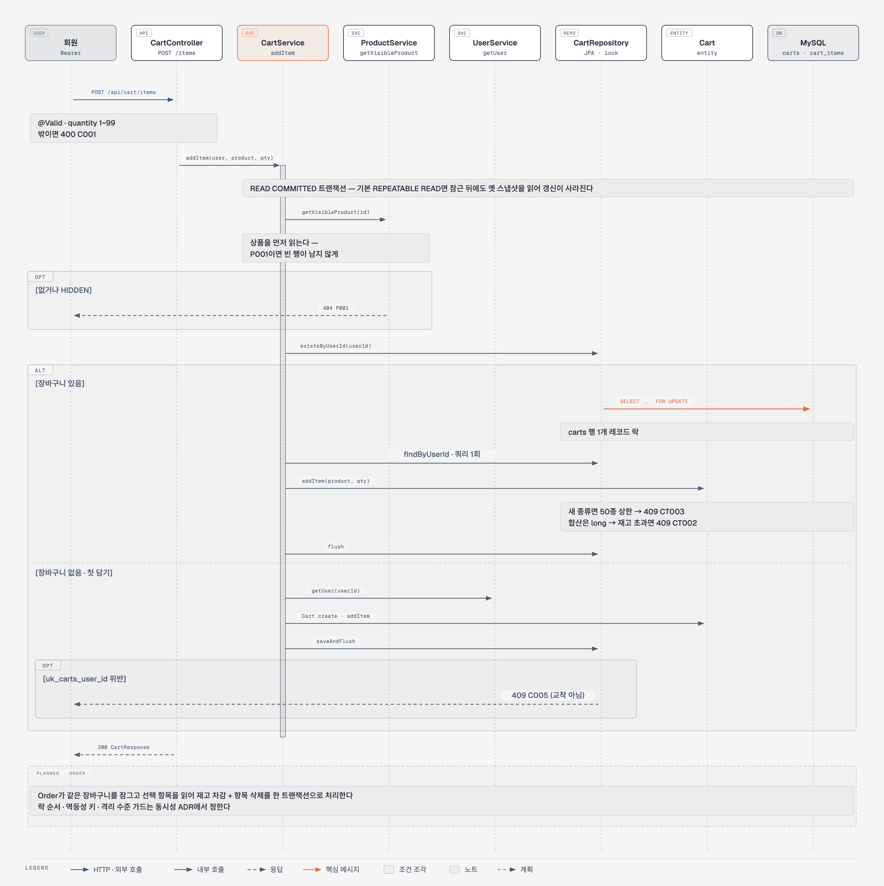
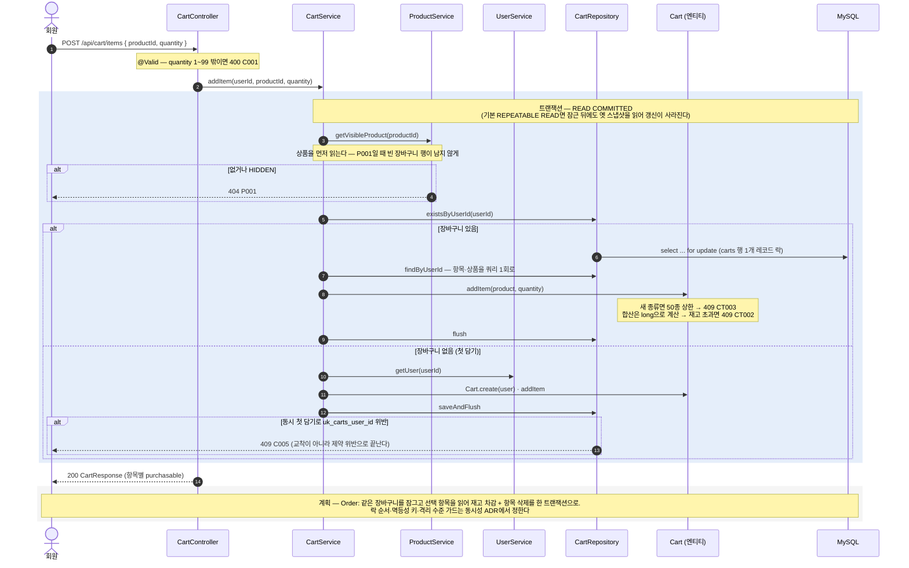

# 장바구니 담기

- **답하는 질문**: 같은 회원의 동시 담기에서 수량이 사라지지 않고, 첫 담기 경합이 왜 409가 되는가
- **범위**: `POST /api/cart/items` 한 건. 주문이 장바구니를 쓰는 부분은 계획이라 점선으로만 표시한다
- **원천**: [cart.md](../../domains/purchase/cart.md) · ADR [0016](../../decisions/purchase/0016-stock-reserved-at-order-not-cart.md) · [0019](../../decisions/purchase/0019-cart-owns-item-deletion.md) · [0020](../../decisions/purchase/0020-cart-writes-use-read-committed.md)

Mermaid 원본 — 내용은 이 블록이 기준이고 PNG는 여기서 다시 그린다

## 읽는 법

- **장바구니는 재고를 점유하지 않는다.** 담을 때 재고를 넘는지만 보고, 차감은 주문이 한다(ADR 0016).
  그래서 담은 뒤 재고가 줄면 항목은 남고 `purchasable`만 `false`가 된다
- 없는 행에 `FOR UPDATE`를 걸면 MySQL이 gap lock을 잡아 교착이 날 수 있다. 그래서 존재를 먼저 확인하고,
  없으면 잠그지 않고 만든 뒤 **uk 제약이 경합을 막게** 한다
- 격리 수준은 `CartService`가 트랜잭션을 **새로 열 때만** 적용된다. 바깥 트랜잭션 안에서 부르면 Spring이 조용히 무시한다 —
  Order가 이 메서드를 쓸 때의 전제다(ADR 0020)
- 수량 변경·항목 삭제·비우기도 같은 락 경로(`findLockedCart`)를 탄다. 장바구니가 없을 때 수량 변경·항목 삭제는 CT001, 비우기는 빈 장바구니 응답이다
