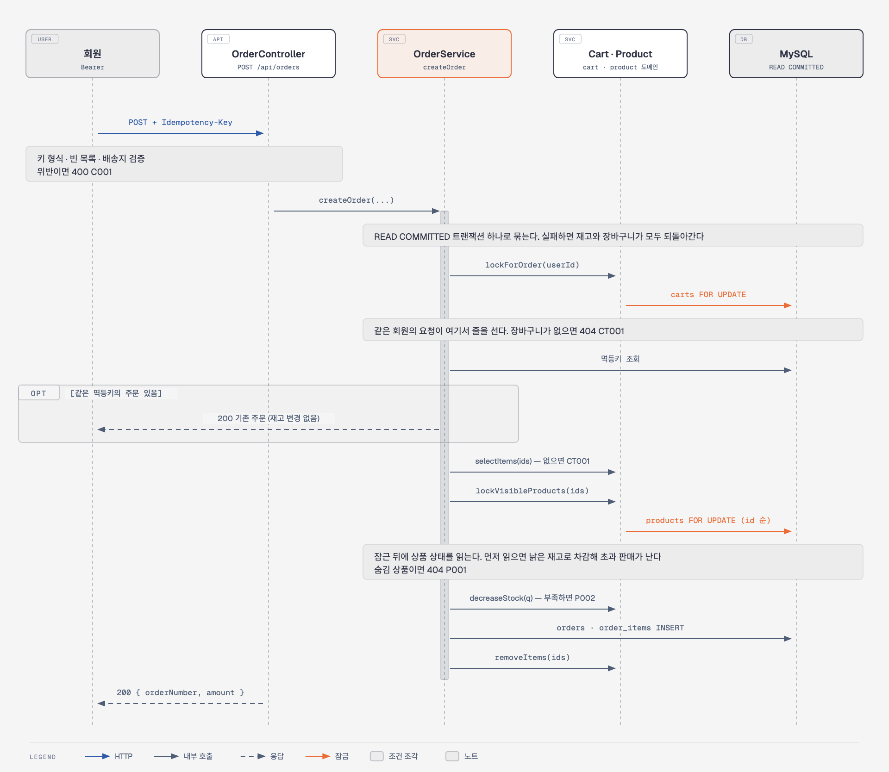
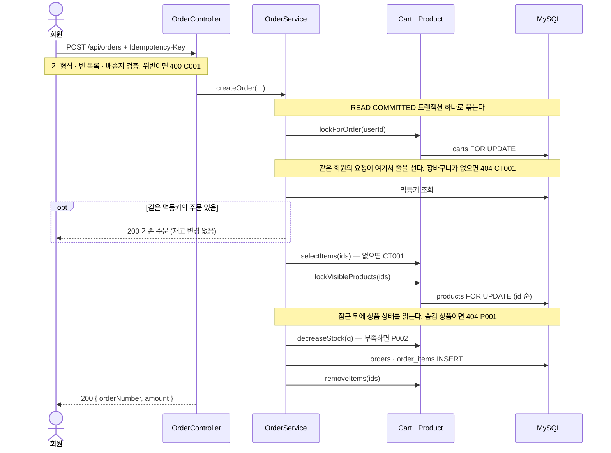

# 주문 생성

- **답하는 질문**: 동시 주문에서 재고가 초과 판매되지 않고, 같은 요청이 왜 주문을 두 번 만들지 않는가
- **범위**: `POST /api/orders` 한 건
- **원천**: [order.md](../../domains/purchase/order.md) · ADR [0024](../../decisions/purchase/0024-order-idempotency-key-in-header.md) · [0025](../../decisions/purchase/0025-pessimistic-lock-as-stock-concurrency-baseline.md) · [0027](../../decisions/purchase/0027-idempotency-uk-violation-responds-conflict.md)

Mermaid 원본 — 내용은 이 블록이 기준이고 PNG는 여기서 다시 그린다

## 읽는 법

- **잠금은 `carts` → `products` 순이다.** `carts` 잠금이 같은 회원의 요청을 줄 세우고, `products` 잠금이 다른 회원과의 재고 경합을 막는다
- **멱등키 조회가 `carts` 잠금 뒤에 있다.** 그래야 먼저 커밋된 주문이 보인다. 앞단을 우회한 중복은 uk가 막고 `C005`(409)로 끝난다
- **상품은 잠그기 전에 읽지 않는다.** Hibernate는 이미 읽은 엔티티를 잠금 쿼리로 갱신하지 않아, 먼저 읽으면 낡은 재고로 차감한다
- 재고 부족으로 실패하면 트랜잭션 전체가 롤백되어 장바구니도 그대로 남는다
