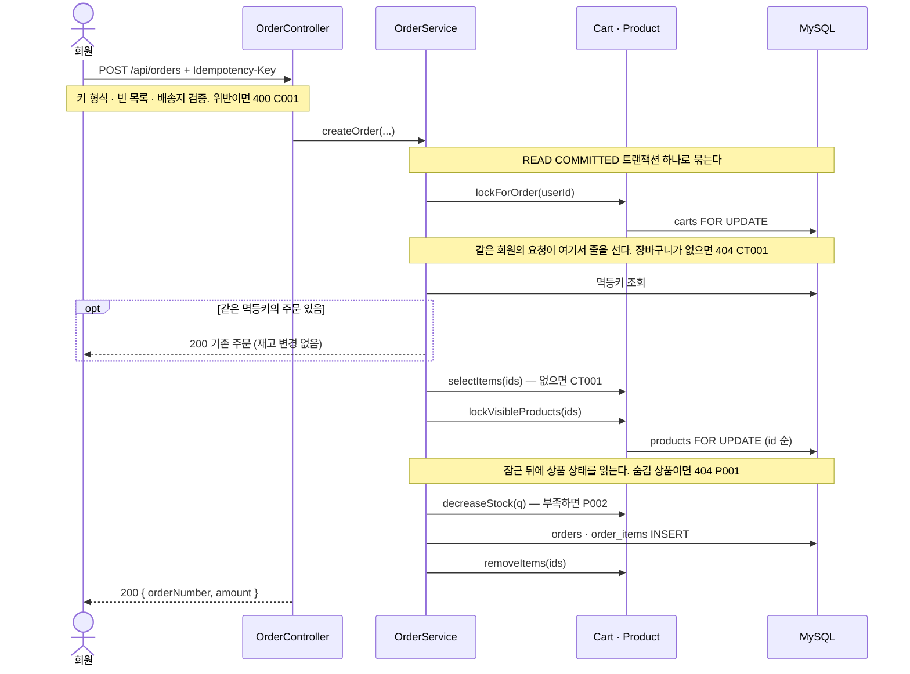

# 3. 주문 생성

> **한 트랜잭션에서 `carts` → `products`(id 순)를 잠그고, 멱등키를 대조하고, 재고를 차감해 `PENDING` 주문을 만든다.**

| | |
|---|---|
| 답하는 질문 | 동시 주문에서 재고가 초과 판매되지 않고, 같은 요청이 왜 주문을 두 번 만들지 않는가 |
| 범위 | `POST /api/orders` 한 건 — 커밋 후 `{ orderNumber, amount }` 응답까지 |
| 근거 | [order.md](../../domains/purchase/order.md) · ADR [0024](../../decisions/purchase/0024-order-idempotency-key-in-header.md) · [0025](../../decisions/purchase/0025-pessimistic-lock-as-stock-concurrency-baseline.md) · [0027](../../decisions/purchase/0027-idempotency-uk-violation-responds-conflict.md) |

## 핵심 흐름

`OrderService.createOrder` 하나가 `READ_COMMITTED` 트랜잭션 하나로 처리한다. **2 → 3 → 5의 순서는 바꾸면 안 된다.**

1. 빈 목록이면 `C001`
2. **`carts` 행을 잠근다** — 같은 회원의 요청이 여기서 줄을 선다
3. **잠근 뒤 멱등키를 조회한다** — 같은 키의 주문이 있으면 그 주문을 200으로 돌려주고 끝(재고 변경 없음)
4. 선택한 항목을 고른다 — 없거나 타인의 항목이면 `CT001`
5. **`products`를 id 오름차순으로 잠근다** — 잠근 뒤의 최신 상태로 숨김 여부를 본다(`P001`)
6. `orderNumber` 발급, 배송지 스냅샷, `PENDING`
7. **재고 차감** + 상품명·가격 스냅샷 — 부족하면 `P002`로 전부 롤백
8. 저장 → 주문한 항목만 장바구니에서 삭제 → `{ orderNumber, amount }` 응답

## 지키는 것

| 불변식 | 깨지면 | 장치 |
|---|---|---|
| 재고는 0 아래로 내려가지 않는다 | 초과 판매 | `products` 비관적 락 + `Product.decreaseStock`의 `P002` |
| 같은 요청은 주문을 한 번만 만든다 | 유령 `PENDING`이 재고를 붙잡는다 | `carts` 락 → 멱등키 대조 → `(user_id, idempotency_key)` 유니크 |
| 실패하면 아무것도 바뀌지 않는다 | 거절됐는데 재고만 빠지거나 장바구니가 빈다 | 차감 · 저장 · 장바구니 삭제를 한 트랜잭션으로 |
| 동시 주문끼리 교착하지 않는다 | InnoDB가 한쪽을 롤백 | 잠금 순서 고정 `carts` → `products`(id 오름차순). 재고 복구 경로도 같은 순서 |

**왜 이 순서인가**
- **멱등키를 잠근 뒤 조회한다.** 잠금 전에 조회하면 두 요청이 동시에 "없음"을 읽고 둘 다 통과한다. READ COMMITTED여야 잠금을 얻은 뒤 앞 요청의 커밋이 보인다
- **상품은 잠그기 전에 읽지 않는다.** Hibernate는 이미 1차 캐시에 있는 엔티티를 잠금 쿼리로 덮어쓰지 않아, 먼저 읽으면 낡은 재고로 차감한다. 1~4단계는 상품 id만 다룬다
- **중복은 거절이 아니라 기존 주문 반환이다.** 응답을 잃고 재시도한 사용자가 주문 성립 여부를 알 수 있다. 잠금을 우회한 비정상 경로만 uk에 걸려 `C005`(409)가 된다

## 경합하면

| 겹치는 상대 | 결과 |
|---|---|
| 다른 회원이 마지막 재고를 주문 | 먼저 잠근 쪽 성공, 뒤 요청 `P002` |
| 상품 구성이 겹치는 주문 | 뒤 요청이 기다렸다 진행 (교착 없음) |
| 같은 회원의 같은 키 (더블 클릭) | 두 번째는 기존 주문 반환 |
| 같은 회원의 다른 키 (앱·웹 동시) | 두 번째는 항목이 이미 지워져 `CT001` |
| 인기 상품에 주문 폭주 | 대기자가 커넥션을 쥐고 기다린다 — 측정 대상(락 타임아웃 미설정) |

## 코드 위치

| 단계 | 코드 |
|---|---|
| 진입 | `OrderController.createOrder` (멱등키 헤더 검증) → `OrderService.createOrder` |
| 2 | `CartService.lockForOrder` → `CartRepository.lockByUserId` |
| 3 | `OrderRepository.findByUserIdAndIdempotencyKey` |
| 5 | `ProductService.lockVisibleProducts` → `ProductRepository.lockAllByIdIn` |
| 7 | `Product.decreaseStock` · `Order.addItem` |
| 격리 수준 검증 | `JpaConfig.validateExistingTransaction` |

Mermaid 원본 — 내용은 이 블록이 기준이고 PNG는 여기서 다시 그린다

---

[← 이전: 2. 장바구니 담기](seq-cart-add.md) · [목차](README.md) · [다음: 4. 결제 승인 →](seq-payment-confirm.md)
