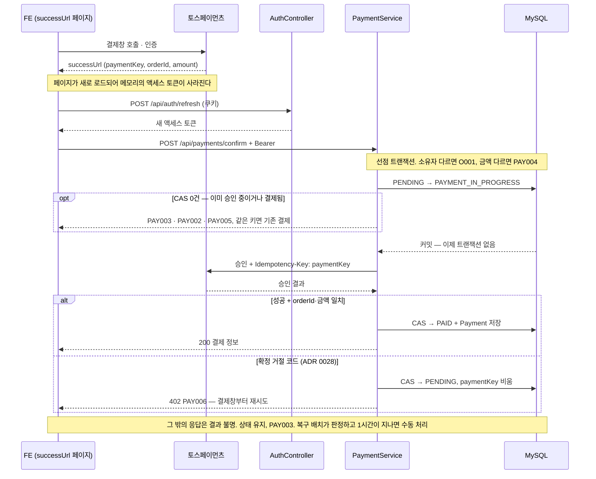

# 결제 승인

> 이 그림은 [ADR 0026](../../decisions/purchase/0026-payment-confirm-outside-transaction.md)·[0028](../../decisions/purchase/0028-payment-result-whitelist-and-recovery-limit.md)의 설계다. 구현 진행은 [roadmap.md](../../roadmap.md)가 소유한다.

- **답하는 질문**: 되돌릴 수 없는 토스 승인을 어떻게 한 번만 호출하고, 서버가 죽어도 어떻게 복구하는가
- **범위**: 토스 결제창 인증부터 `POST /api/payments/confirm` 응답까지
- **원천**: [payment.md](../../domains/purchase/payment.md) · [auth.md](../../domains/auth.md) FE 계약 · ADR [0026](../../decisions/purchase/0026-payment-confirm-outside-transaction.md) · [0028](../../decisions/purchase/0028-payment-result-whitelist-and-recovery-limit.md)

Mermaid 원본 — 내용은 이 블록이 기준이고 PNG는 여기서 다시 그린다

## 읽는 법

**세션 복구**
- successUrl로 오면 페이지가 새로 로드되어 FE 메모리의 액세스 토큰이 사라진다. 그대로 승인을 부르면 401이다
- 그래서 먼저 `POST /api/auth/refresh`로 토큰을 받는다. [auth.md](../../domains/auth.md) FE 계약의 "앱 부팅 시 세션 복구"와 같은 호출이다
- refresh 요청은 토스가 아니라 우리 FE 페이지가 보내므로 `SameSite=Strict` 쿠키가 전송된다. 카카오 로그인 뒤 `/oauth/complete`와 같은 구조다
- refresh가 401이면 로그인 화면으로 보낸다. 승인하지 않은 결제는 토스에서 만료되고 주문은 `PENDING`이라, 다시 로그인한 뒤 결제를 이어가면 된다

**선점과 승인**
- **토스 호출은 트랜잭션 밖이다.** 승인은 롤백할 수 없고, 호출 중 커넥션을 쥐면 토스 지연이 커넥션 풀 고갈로 번진다
- **중복 호출은 상태 CAS가 막는다.** `PAYMENT_IN_PROGRESS`가 커밋되면 이후 요청은 선점에 실패해 토스를 호출하지 않는다
- 선점 때 `paymentKey`를 함께 저장한다. 복구 조회의 키이고, 반영 CAS가 이 값까지 비교해 늦게 끝난 이전 시도가 새 시도를 건드리지 못한다
- 토스에도 `Idempotency-Key: {paymentKey}`를 보낸다. 다만 중복 방어는 이 헤더가 아니라 CAS와 unique가 맡는다
- successUrl의 세 값은 사용자가 고칠 수 있다. 금액은 선점 전에 주문과 대조하고, 성공 응답의 `orderId`와 금액도 주문과 일치해야 `PAID`가 된다

**결과 판정**
- **확정 거절은 목록에 있는 토스 코드만이다.** 카드 거절, 한도, 할부, 세션 없음 등 31개다([ADR 0028](../../decisions/purchase/0028-payment-result-whitelist-and-recovery-limit.md))
- **나머지는 결과 불명이다.** 토스에서 승인됐을 수 있어 `PENDING`으로 돌리면 재시도가 중복 청구가 될 수 있다
- 결과 불명은 복구 배치가 토스 조회로 판정한다. 1시간이 지나도 판정되지 않으면 자동으로 취소하지 않고 ERROR 로그를 남겨 수동 처리로 넘긴다. 돈이 빠져나갔을 수 있어서다
