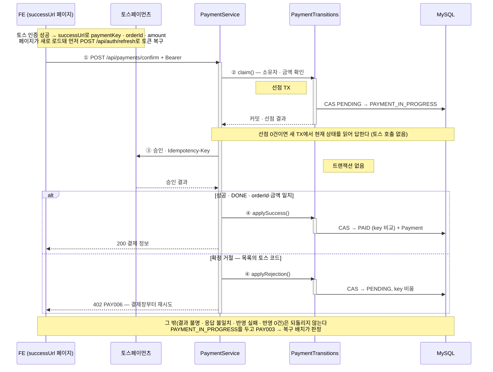

# 결제 승인

> 이 그림은 Phase 4 · 10단계에서 구현한 승인 흐름이다. 설계 근거는 [ADR 0026](../../decisions/purchase/0026-payment-confirm-outside-transaction.md)·[0028](../../decisions/purchase/0028-payment-result-whitelist-and-recovery-limit.md)·[0030](../../decisions/purchase/0030-recovery-batch-runtime-limits.md), 구현 진행은 [roadmap.md](../../roadmap.md)가 소유한다.

- **답하는 질문**: 되돌릴 수 없는 토스 승인을 어떻게 한 번만 호출하고, 결과를 모를 때 어떻게 넘기는가
- **범위**: 토스 결제창 인증 뒤 successUrl 도착부터 `POST /api/payments/confirm` 응답까지
- **원천**: [payment.md](../../domains/purchase/payment.md) · [auth.md](../../domains/auth.md) FE 계약 · `PaymentService` · `PaymentTransitions`

Mermaid 원본 — 내용은 이 블록이 기준이고 PNG는 여기서 다시 그린다

## 그림 따라 읽기

그림의 번호 순서대로 읽는다. 각 단계는 **무엇을 하나** → **왜 그렇게 하나** 순서다.

### 0. successUrl 도착과 세션 복구 — 맨 위 노트

**무엇을 하나**
- 토스 결제창에서 인증이 끝나면 토스가 브라우저를 successUrl(FE 페이지)로 보낸다. 쿼리에 `paymentKey` · `orderId` · `amount`가 붙는다
- FE는 승인 API보다 먼저 `POST /api/auth/refresh`로 액세스 토큰을 받는다

**왜 그렇게 하나**
- **토큰이 사라졌다.** 리다이렉트로 페이지가 새로 로드돼 메모리에 있던 액세스 토큰이 없다. 그대로 승인을 부르면 401이다
- **쿠키가 실린다.** refresh는 토스가 아니라 우리 FE 페이지가 보내므로 `SameSite=Strict` 쿠키가 전송된다. 카카오 로그인 뒤 `/oauth/complete`와 같은 구조이고, [auth.md](../../domains/auth.md)의 "앱 부팅 시 세션 복구"와 같은 호출이다
- **successUrl을 백엔드로 두지 않는다.** 토스의 리다이렉트에는 `Authorization` 헤더가 없어 인증되지 않는다

**실패하면**
- refresh가 401이면 로그인 화면으로 보낸다. 승인하지 않은 결제는 토스에서 만료되고 주문은 `PENDING`이라, 다시 로그인한 뒤 같은 주문으로 결제를 이어가면 된다

### ① 승인 요청

- FE가 successUrl에서 받은 세 값을 그대로 보낸다. `orderId`는 토스 쪽 이름이고 값은 `Order.orderNumber`다
- **세 값은 모두 사용자가 고칠 수 있다.** 리다이렉트 쿼리라서다. 그래서 ②에서 금액을, ④ 직전에 토스 응답을 주문과 대조한다
- `PaymentService`는 `@Transactional`이 없다. 흐름만 잡고, 트랜잭션은 ②와 ④에서 `PaymentTransitions`가 따로 연다

### ② 선점 TX — 승인 진입을 한 번만 허용한다

**무엇을 하나**
1. `orderNumber` + 회원으로 주문을 찾는다. 없거나 타인의 주문이면 `O001`
2. 요청 금액과 `Order.totalAmount`를 비교한다. 다르면 `PAY004`이고 토스를 부르지 않는다
3. CAS `PENDING → PAYMENT_IN_PROGRESS`, 같은 문장에서 `paymentKey`를 저장한다
4. 커밋한다

**왜 그렇게 하나**
- **중복 호출을 CAS가 막는다.** 선점이 커밋되면 같은 주문의 다른 요청은 CAS가 0건이 되어 토스를 부르지 못한다. 동시 승인 2건이 와도 토스 호출은 1번이다
- **`paymentKey`를 함께 저장한다.** 호출 중 서버가 죽어도 복구 배치가 이 키로 토스를 조회할 수 있다. ④의 반영 CAS도 이 값을 비교한다

**선점이 0건이면** — 그림의 노트. 새 트랜잭션에서 주문을 다시 읽어 답한다

| 현재 상태 | 응답 |
|---|---|
| `PAYMENT_IN_PROGRESS` | `PAY003` 승인 진행 중 |
| `PAID` + 같은 `paymentKey` | 기존 결제 반환 — 응답을 잃은 FE의 재시도다 |
| `PAID` + 다른 `paymentKey` | `PAY002` |
| 그 밖 (`CANCELLED` 등) | `PAY005` |

새 트랜잭션에서 읽는 이유: MySQL 기본 격리 수준(REPEATABLE READ)에서는 같은 트랜잭션 안의 재조회가 처음 읽은 시점의 스냅샷을 돌려줘, 다른 요청이 커밋한 상태를 놓친다.

### ③ 토스 승인 — 트랜잭션 밖

**무엇을 하나**
- `PaymentGateway.confirm()`이 토스 승인 API를 부른다. `Idempotency-Key: {paymentKey}`를 함께 보낸다
- 자동 재시도는 하지 않는다

**왜 트랜잭션 밖인가**
- **승인은 롤백할 수 없다.** 트랜잭션 안에서 부르고 롤백해도 토스의 승인은 남는다
- **토스 지연이 번지지 않는다.** 응답을 기다리는 동안(읽기 타임아웃 30초) 커넥션과 행 잠금을 쥐면, 토스가 느려질 때 커넥션 풀이 고갈된다

**`Idempotency-Key`의 역할**
- 같은 키로 다시 부르면 토스는 첫 응답을 그대로 돌려준다(테스트 키로 확인)
- 다만 중복 방어의 주체는 이 헤더가 아니라 ②의 CAS와 `payments`의 unique 제약이다

### ④ 반영 TX — 결과를 주문에 옮긴다

토스 응답은 세 가지로 나뉜다([ADR 0028](../../decisions/purchase/0028-payment-result-whitelist-and-recovery-limit.md)). 그림의 `ALT`가 앞의 둘이다.

**성공 — `applySuccess()`**
- 반영 전에 응답을 검증한다. `status`가 `DONE`이고 `orderId` · 금액이 주문과 같아야 한다. 다른 주문의 `paymentKey`로 승인을 받아 오는 것을 막는다
- CAS `PAYMENT_IN_PROGRESS → PAID`. 1건일 때만 같은 트랜잭션에서 `Payment(SUCCESS)`를 저장한다
- 200으로 결제 정보를 돌려준다. 결제 PK와 `paymentKey`는 내보내지 않는다

**확정 거절 — `applyRejection()`**
- 목록에 있는 토스 코드만 거절이다. 카드 거절, 한도, 할부, 세션 없음 등 31개다
- CAS `PAYMENT_IN_PROGRESS → PENDING`, `paymentKey`를 비운다. 결제 행은 남기지 않는다 — 남기면 그 주문의 재시도가 unique 제약에 막힌다
- `402 PAY006`. 재고는 점유된 채 남고, 사용자는 **결제창부터** 같은 주문으로 다시 시도한다

**결과 불명 — 그림 맨 아래 노트**
- 목록에 없는 코드, 5xx, 타임아웃, 해석할 수 없는 응답이다
- 토스에서 승인됐을 수 있어 `PENDING`으로 돌리지 않는다. 돌리면 재시도가 중복 청구가 될 수 있다
- `PAYMENT_IN_PROGRESS`와 `paymentKey`를 그대로 두고 `PAY003`으로 답한다. [복구 배치](seq-payment-recovery.md)가 토스를 조회해 판정한다

**두 반영 CAS 모두 `paymentKey`를 비교한다.** 멈췄다 돌아온 이전 시도는 키가 달라 0건으로 끝나고, 그사이 새로 선점한 시도를 건드리지 못한다(ABA). 반영 트랜잭션은 10초가 상한이라 요청 최대 수명이 정해진다([ADR 0030](../../decisions/purchase/0030-recovery-batch-runtime-limits.md)).

## 예외 경로

그림에 그리지 않은 경우다. 공통 원칙은 **토스가 승인했을 수 있으면 실패로 답하지 않는다**이다. 실패로 답하면 사용자가 다시 결제한다.

| 상황 | 응답 | 처리 |
|---|---|---|
| 토스 결과 불명 | `PAY003` | 상태 유지. 경보 코드면 ERROR, 아니면 WARN |
| 승인 응답이 `DONE`이 아니거나 `orderId` · 금액이 다름 | `PAY003` | ERROR, 전이하지 않음 |
| 성공 반영 트랜잭션 실패 (DB 예외 · 타임아웃) | `PAY003` | ERROR, 상태 유지 → 배치가 `PAID`로 전진 |
| 성공 반영 0건, 같은 키로 이미 `PAID` | 기존 결제 반환 | 정상 — 배치가 먼저 반영했다 |
| 성공 반영 0건, 그 밖 | `PAY003` | ERROR — 토스 결과와 주문이 어긋남, 수동 처리 |
| 거절 반영 0건 · 실패 | `PAY006` | 토스 거절은 확정이라 응답은 그대로. 상태가 `PENDING`이 아니면 ERROR |

0건 뒤의 재확인도 ②와 같은 이유로 새 트랜잭션에서 한다.

## 코드 위치

| 그림의 단계 | 메서드 |
|---|---|
| ① | `PaymentController.confirm` → `PaymentService.confirm` |
| ② | `PaymentTransitions.claim`, 0건이면 `resolveUnclaimed` |
| ③ | `PaymentGateway.confirm` → `TossPaymentGateway` |
| ④ | `PaymentTransitions.applySuccess` · `applyRejection`, 0건이면 `findPaid` · `currentStatus` |
| CAS | `OrderRepository.claimPayment` · `applyPaymentSuccess` · `applyPaymentRejection` |
