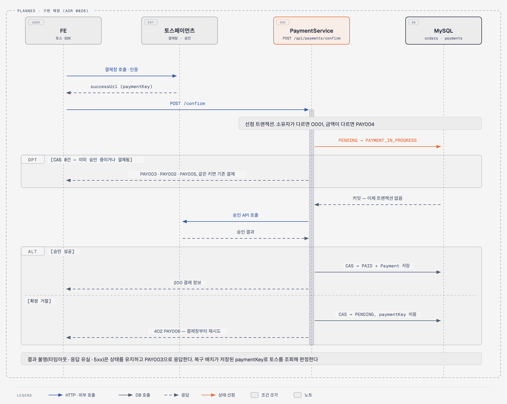
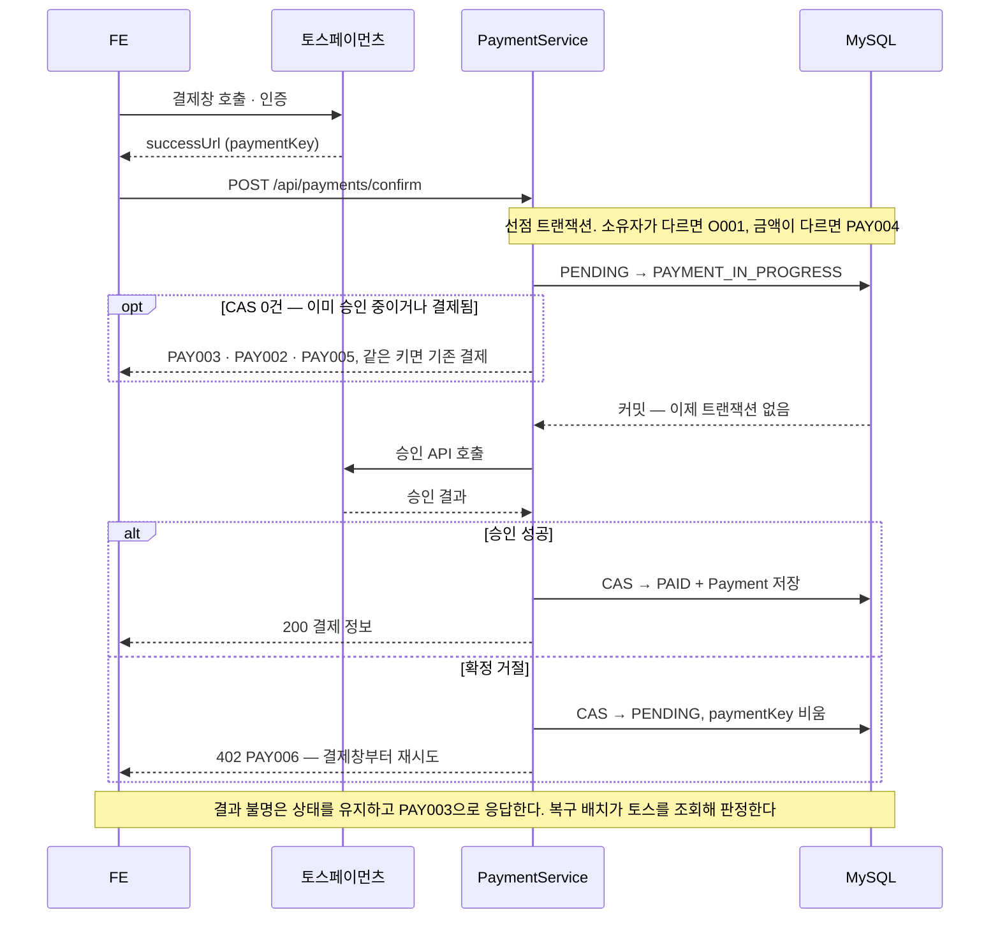

# 결제 승인

> Payment는 아직 구현 전이다. 이 그림은 [ADR 0026](../../decisions/purchase/0026-payment-confirm-outside-transaction.md)의 설계다.

- **답하는 질문**: 되돌릴 수 없는 토스 승인을 어떻게 한 번만 호출하고, 서버가 죽어도 어떻게 복구하는가
- **범위**: 토스 결제창 인증부터 `POST /api/payments/confirm` 응답까지
- **원천**: [payment.md](../../domains/purchase/payment.md) · ADR [0026](../../decisions/purchase/0026-payment-confirm-outside-transaction.md)

Mermaid 원본 — 내용은 이 블록이 기준이고 PNG는 여기서 다시 그린다

## 읽는 법

- **토스 호출은 트랜잭션 밖이다.** 승인은 롤백할 수 없고, 호출 중 커넥션을 쥐면 토스 지연이 커넥션 풀 고갈로 번진다
- **중복 호출은 상태 CAS가 막는다.** `PAYMENT_IN_PROGRESS`가 커밋되면 이후 요청은 선점에 실패해 토스를 호출하지 않는다
- **결과를 모르면 되돌리지 않는다.** 토스에서 승인됐을 수 있어, `PENDING`으로 돌리면 재시도가 중복 청구가 될 수 있다
- 반영 CAS는 `payment_key`까지 비교해, 늦게 끝난 이전 시도가 새 시도의 선점을 건드리지 못한다
