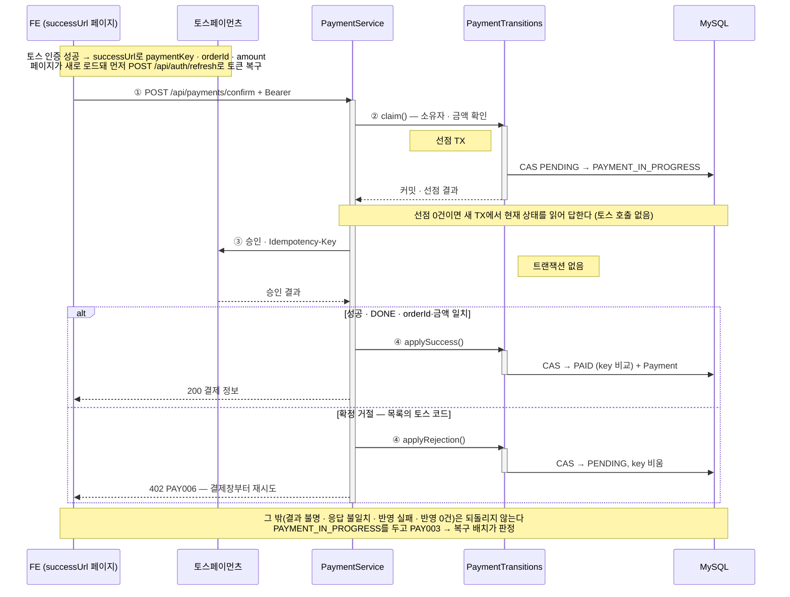

# 4. 결제 승인

> **선점 TX → 토스 승인(트랜잭션 밖) → 반영 TX. 선점에 성공한 요청 하나만 토스를 부르고, 결과를 모르면 되돌리지 않는다.**

| | |
|---|---|
| 답하는 질문 | 되돌릴 수 없는 토스 승인을 어떻게 한 번만 호출하고, 결과를 모를 때 어떻게 넘기는가 |
| 범위 | 토스 결제창 인증 뒤 successUrl 도착부터 `POST /api/payments/confirm` 응답까지 |
| 근거 | [payment.md](../../domains/purchase/payment.md) · ADR [0026](../../decisions/purchase/0026-payment-confirm-outside-transaction.md) · [0028](../../decisions/purchase/0028-payment-result-whitelist-and-recovery-limit.md) · [0030](../../decisions/purchase/0030-recovery-batch-runtime-limits.md) |

## 핵심 흐름

`PaymentService`에는 `@Transactional`이 없다. 트랜잭션은 별도 빈 `PaymentTransitions`에만 있다 — 같은 클래스에서 부르면 프록시를 거치지 않아 트랜잭션이 조용히 빠지기 때문이다.

| 그림 | 단계 | 핵심 |
|---|---|---|
| 0 | successUrl 도착 | 페이지가 새로 로드돼 토큰이 없다. 승인보다 먼저 `POST /api/auth/refresh`로 복구한다 |
| ① | 승인 요청 | successUrl의 `paymentKey` · `orderId` · `amount`를 그대로 보낸다. **세 값 모두 사용자가 고칠 수 있다** |
| ② | 선점 TX | 내 주문인지(`O001`), 금액이 같은지(`PAY004`, 토스 호출 없음) 본 뒤 CAS `PENDING → PAYMENT_IN_PROGRESS` + `paymentKey` 저장 |
| ③ | 토스 승인 | 트랜잭션 밖, `Idempotency-Key: {paymentKey}`, 읽기 30초, 자동 재시도 없음 |
| ④ | 반영 TX | 성공 → `PAID` + `Payment` 저장 / 확정 거절 → `PENDING`, `paymentKey` 비움 |

**선점이 0건이면** 새 트랜잭션에서 지금 상태를 읽어 답한다(토스 호출 없음).

| 지금 상태 | 응답 |
|---|---|
| `PAYMENT_IN_PROGRESS` | `PAY003` — 다른 요청이 승인 중 |
| `PAID` + 같은 `paymentKey` | 200 기존 결제 — 응답을 잃은 FE의 재시도 |
| `PAID` + 다른 `paymentKey` | `PAY002` |
| 그 밖 (만료·취소) | `PAY005` |

## 지키는 것

| 불변식 | 깨지면 | 장치 |
|---|---|---|
| 토스 승인은 주문당 한 번만 | 중복 청구 | 선점 CAS + `payments`의 `order_id` · `payment_key` 유니크 |
| 돈이 나갔으면 결국 `PAID`가 된다 | 결제됐는데 결제 대기로 남아 사용자가 재결제 | 결과를 모르면 `PAYMENT_IN_PROGRESS` 유지 → 복구 배치 |
| 고친 값으로 승인되지 않는다 | 적은 금액·다른 주문의 결제로 `PAID` | 선점 전 금액 대조 + 응답의 `DONE` · `orderId` · 금액 검증(`matches`) |
| 늦게 끝난 이전 시도가 새 시도를 덮지 않는다 | 거절 후 재시도한 결제가 뒤집힌다(ABA) | 반영 CAS가 `payment_key`까지 비교 |
| 토스 지연이 서비스 전체로 번지지 않는다 | 커넥션 풀 고갈 | 호출을 트랜잭션 밖으로, `open-in-view: false`, 모든 구간 타임아웃 |

**왜 트랜잭션 밖인가** — 승인은 롤백해도 토스에 남고, 응답을 기다리는 최대 30초 동안 커넥션과 행 잠금을 쥐면 토스가 느려질 때 무관한 API까지 멈춘다. 그 대신 생기는 무방비 구간을 선점 CAS(중복 호출)와 `payment_key` 비교(ABA)가 지킨다.

## 실패하면

원칙은 하나다 — **토스가 승인했을 수 있으면 실패로 답하지 않는다.** 실패로 답하면 사용자가 다시 결제한다.

| 상황 | 응답 | 주문 |
|---|---|---|
| 확정 거절 (목록의 31개 코드) | 402 `PAY006` — 결제창부터 재시도 | `PENDING` |
| 결과 불명 (5xx · 타임아웃 · 모르는 코드) | `PAY003` | `PAYMENT_IN_PROGRESS` 유지 → 배치 |
| 응답이 `DONE`이 아니거나 주문과 다름 | `PAY003` + ERROR | 유지 |
| 성공 반영 실패 (DB 예외 · 타임아웃) | `PAY003` + ERROR | 유지 → 배치가 `PAID`로 |
| 성공 반영 0건, 이미 같은 키로 `PAID` | 200 기존 결제 | 정상 — 배치가 먼저 반영 |

`PAY003`을 받은 FE는 재결제를 유도하지 않고 `GET /api/payments/{orderNumber}`로 결과를 확인한다.

## 코드 위치

| 그림 | 코드 |
|---|---|
| ① | `PaymentController.confirm` → `PaymentService.confirm` |
| ② | `PaymentTransitions.claim`, 0건이면 `resolveUnclaimed` |
| ③ | `PaymentGateway.confirm` → `TossPaymentGateway` ([5. 결제 게이트웨이](payment-gateway.md)) |
| ④ | `PaymentTransitions.applySuccess` · `applyRejection`, 0건이면 `findPaid` |
| CAS | `OrderRepository.claimPayment` · `applyPaymentSuccess` · `applyPaymentRejection` |

Mermaid 원본 — 내용은 이 블록이 기준이고 PNG는 여기서 다시 그린다

---

[← 이전: 3. 주문 생성](seq-order-create.md) · [목차](README.md) · [다음: 5. 결제 게이트웨이 →](payment-gateway.md)
