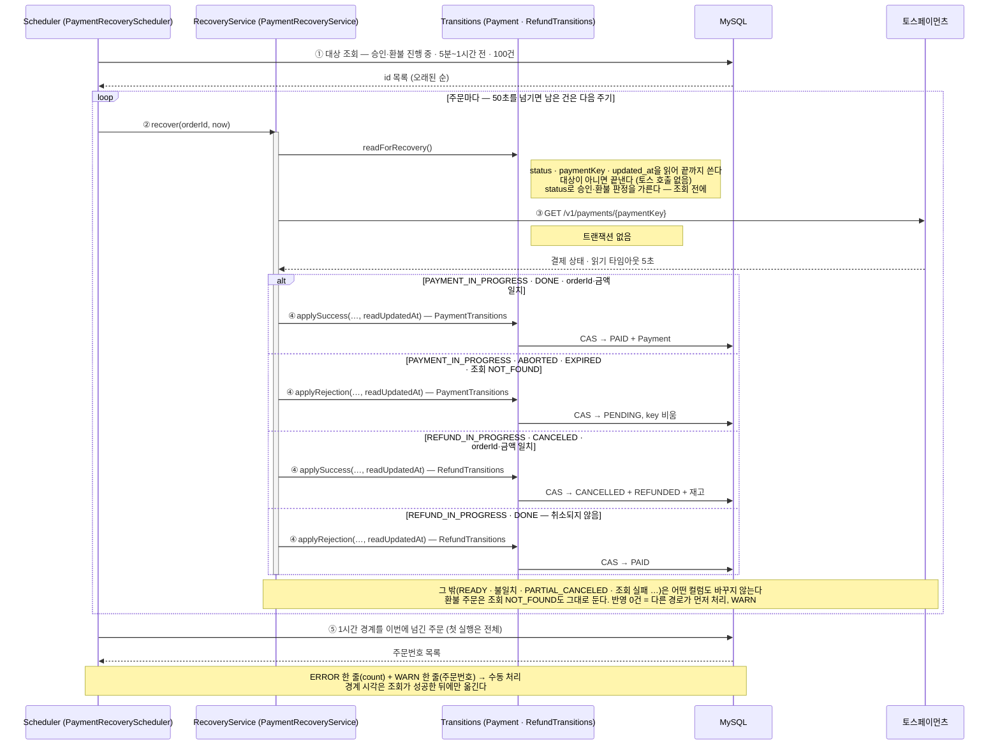

# 결제 복구 배치

> 이 그림은 Phase 4 · 11단계의 **승인 판정**과 12단계에서 같은 배치에 더한 **환불 판정**이다. 설계 근거는 [ADR 0029](../../decisions/purchase/0029-refund-outside-transaction.md)· [ADR 0026](../../decisions/purchase/0026-payment-confirm-outside-transaction.md)·[0028](../../decisions/purchase/0028-payment-result-whitelist-and-recovery-limit.md)·[0030](../../decisions/purchase/0030-recovery-batch-runtime-limits.md), 구현 진행은 [roadmap.md](../../roadmap.md)가 소유한다.

- **답하는 질문**: 결과를 모른 채 `PAYMENT_IN_PROGRESS`·`REFUND_IN_PROGRESS`에 멈춘 주문을 어떻게 토스 기준으로 바로잡고, 판정되지 않는 주문은 어떻게 넘기는가
- **범위**: `PaymentRecoveryScheduler` 한 번 실행. 판정 표는 [payment.md](../../domains/purchase/payment.md)의 "복구 배치"가 기준이다
- **원천**: [payment.md](../../domains/purchase/payment.md) · `PaymentRecoveryScheduler` · `PaymentRecoveryService` · `PaymentTransitions` · `RefundTransitions`

Mermaid 원본 — 내용은 이 블록이 기준이고 PNG는 여기서 다시 그린다

## 그림 따라 읽기

그림의 번호 순서대로 읽는다. 각 단계는 **무엇을 하나** → **왜 그렇게 하나** 순서다.

### 0. 언제, 어디서 도나

- 1분마다 돈다(`fixedDelay`). 앞 실행이 끝난 뒤 1분을 센다. 그래서 한 인스턴스 안에서는 배치가 자기 자신과 겹치지 않는다
- 인스턴스마다 따로 돈다. 서버가 여러 대면 같은 주문을 동시에 판정할 수 있고, 그 경합은 ④의 CAS가 막는다. 분산 락은 쓰지 않는다
- 스케줄러 스레드는 2개다(`spring.task.scheduling.pool.size`). 토스가 느려 이 배치가 길어져도 `PENDING` 만료 배치는 멈추지 않는다

### ① 대상 조회

**무엇을 하나**
- `updated_at`이 **5분 ~ 1시간 전**인 `PAYMENT_IN_PROGRESS`·`REFUND_IN_PROGRESS` 주문을 오래된 순으로 100건 가져온다(`findRecoveryTargetIds`, `status in`)
- 두 상태는 판정 시간 · 1시간 종결 · 예산 · 경보 규칙이 같아 한 쿼리로 본다(ADR 0029)

**왜 그 구간인가**
- **5분보다 최근인 주문은 보지 않는다.** 요청 하나의 최대 수명은 약 100초다. 그래서 아직 살아 있는 요청과 배치가 같은 주문을 판정하지 않는다
- **1시간이 넘은 주문은 뺀다.** 판정되지 않는 주문이 오래된 순 조회의 앞을 계속 차지하면, 정상적으로 복구될 주문이 밀린다. 1시간이 넘은 주문은 ⑤가 사람에게 넘긴다

### ② 주문마다 판정 — `recover(orderId, now)`

**무엇을 하나**
- 대상 주문을 하나씩 처리한다. 다음 주문을 시작하기 전에 경과 시간을 보고, 50초를 넘겼으면 남은 주문은 다음 주기로 넘긴다
- `readForRecovery()`가 새 읽기 트랜잭션에서 주문의 `status` · `paymentKey` · `updated_at`을 읽는다. 이 세 값은 ④까지 그대로 쓴다

**왜 그렇게 하나**
- **처리 중인 주문은 끊지 않는다.** 조회 결과를 받아 놓고 버리는 낭비를 피한다. 그래서 실제 상한은 50초 + 한 건이다
- **한 건이 실패해도 나머지는 계속한다.** 예외는 WARN으로 남기고 다음 주문으로 넘어간다. 행을 건드리지 않았으니 다음 주기에 다시 판정된다
- **읽은 `status`로 승인·환불 판정을 가른다.** 토스 조회 전에 가르는 이유는 ④의 "환불 판정"을 본다
- **읽은 값이 대상이 아니면 끝낸다** — 그림의 노트. ①에서 고른 뒤 읽기 전에 요청이나 다른 인스턴스가 이미 처리했을 수 있다. 상태가 바뀌었거나 구간을 벗어났으면 토스를 부르지 않는다

### ③ 토스 조회 — 트랜잭션 밖

**무엇을 하나**
- 읽어 둔 `paymentKey`로 `PaymentGateway.getPayment()`를 부른다(`GET /v1/payments/{paymentKey}`)

**왜 그렇게 하나**
- **트랜잭션 밖이다.** 조회가 느려도 커넥션과 행 잠금을 쥐지 않는다
- **읽기 타임아웃이 5초로 짧다.** 승인·취소(30초)와 다른 클라이언트를 쓴다. 조회는 실패해도 다음 주기에 다시 하면 되고, 배치를 오래 붙잡으면 안 된다

### ④ 반영 — 요청 경로와 같은 메서드

조회 결과가 아래 넷 중 하나일 때만 반영한다. 그림의 `ALT`가 그 넷이다. 위 둘은 승인 판정(`PaymentTransitions`), 아래 둘은 환불 판정(`RefundTransitions`)이다.

**승인됨 — `applySuccess()`**
- `status`가 `DONE`이고 `orderId` · 금액이 주문과 같을 때다
- CAS `PAYMENT_IN_PROGRESS → PAID`, 1건일 때만 같은 트랜잭션에서 `Payment(SUCCESS)`를 저장한다

**승인되지 않음 — `applyRejection()`**
- `ABORTED` · `EXPIRED`이거나, 조회가 `NOT_FOUND_PAYMENT`로 거절됐을 때다. 토스에 결제가 끝나지 않았거나 아예 없다
- CAS `PAYMENT_IN_PROGRESS → PENDING`, `paymentKey`를 비운다. 사용자는 같은 주문으로 다시 결제할 수 있다

**환불됨 — `RefundTransitions.applySuccess()`** (12단계)
- 주문이 `REFUND_IN_PROGRESS`이고 조회가 `CANCELED`, `orderId` · 금액이 같을 때다
- 요청 경로의 환불 성공과 같은 반영이다. CAS `REFUND_IN_PROGRESS → CANCELLED`, `Payment(REFUNDED)`, 재고 복구가 한 트랜잭션이다

**취소되지 않음 — `RefundTransitions.applyRejection()`** (12단계)
- 조회가 `DONE`일 때다. 토스는 취소하지 않았다
- CAS `REFUND_IN_PROGRESS → PAID`. 사용자가 다시 취소하면 같은 멱등키 `cancel-{paymentKey}`가 나가 토스가 중복 취소를 막는다

**환불 판정은 토스 조회 전에 가른다**
- 승인 판정은 조회가 `NOT_FOUND_PAYMENT`로 거절되면 `PENDING`으로 되돌린다. 환불 주문에 이 규칙이 적용되면 결제가 있던 주문이 결제 전 상태로 돌아간다
- 그래서 `recover()`가 ②에서 읽은 `status`로 먼저 가르고, 환불 주문은 `NOT_FOUND_PAYMENT`도 판정 불가(WARN, 변경 없음)로 둔다

**네 CAS 모두 읽은 `updated_at`을 비교한다**
- 10단계 요청 경로가 쓰는 메서드와 같다. 배치는 여기에 `readUpdatedAt`(②에서 읽은 값)을 넘긴다
  - 요청 경로는 `null`을 넘겨 이 조건을 건너뛴다(`readUpdatedAt is null or updated_at = readUpdatedAt`)
- 모든 상태 전이는 `updated_at`을 새로 쓴다. 그래서 `updated_at`이 읽은 값 그대로면, 그사이 아무도 행을 바꾸지 않았다는 뜻이다
- 읽은 뒤 누가 행을 바꿨으면 상태와 키가 같아도 0건이 된다. 옛 조회 결과가 새 시도에 반영되지 않는다(ABA)
- 조회에 쓴 `paymentKey`도 그대로 넘긴다. 그사이 거절 → 재선점으로 키가 바뀌었으면 역시 0건이다(승인만)
- 환불 CAS는 `payment_key`를 비교하지 않는다. `PAID`로 되돌린 뒤 사용자가 다시 취소한 새 시도는 `updated_at`이 달라 막힌다

**그 밖 — 그림의 아래 노트**
- 아래 결과는 **어떤 컬럼도 바꾸지 않는다.** `updated_at`도 그대로다

| 조회 결과 | 로그 | 이유 |
|---|---|---|
| `READY`, `IN_PROGRESS` | DEBUG | 아직 진행 중. 토스에서 만료되면 다음 조회가 `EXPIRED`로 정리한다 |
| `DONE` + `orderId`·금액 불일치 | WARN | 다른 주문의 결제다. 1시간 뒤 사람이 본다 |
| 승인 판정: `CANCELED`, `PARTIAL_CANCELED`, `WAITING_FOR_DEPOSIT`, 모르는 상태 | WARN | 이 흐름에서 나올 수 없는 상태다. 1시간 뒤 사람이 본다 |
| 환불 판정: `CANCELED`·`DONE` 외 전부, `orderId`·금액 불일치 | WARN | 부분 취소 등 이 흐름에서 나올 수 없는 상태다. 1시간 뒤 사람이 본다 |
| 환불 판정: 조회 `NOT_FOUND_PAYMENT` | WARN | 결제가 있던 주문이다. 되돌리지 않고 사람이 본다 |
| 조회 결과 불명 (5xx · 타임아웃 · 경보 코드) | WARN | 다음 주기에 다시 조회한다 |

- **`updated_at`을 건드리지 않는 이유**: 1시간 종결은 `updated_at`을 기준으로 한다. 판정하지 못할 때마다 갱신하면 시계가 계속 리셋돼, 영원히 사람에게 넘어가지 않는다
- **ERROR가 아니라 WARN인 이유**: 1분마다 같은 주문을 다시 보므로 ERROR면 1시간에 60번 찍힌다. 판정되지 않은 주문은 ⑤가 ERROR로 한 번 알린다(ADR 0030)

**반영이 0건이면**
- 읽은 뒤 요청이나 다른 인스턴스가 먼저 처리한 것이다. 정상이라 WARN으로 끝낸다
- 그 주문은 `updated_at`이 바뀌어, 아직 판정되지 않았더라도 다시 5분이 지나야 대상이 된다

### ⑤ 1시간 경보

**무엇을 하나**
- 이번 실행에서 1시간 경계를 막 넘긴 주문만 찾는다(`findAbandonedOrderNumbers`). 구간은 `(직전 경계, 이번 경계]`다
- 있으면 ERROR 한 줄(`결제 1시간 미판정, 수동 처리 필요 count=N`)과 주문번호 목록 WARN 한 줄을 남긴다

**왜 그렇게 하나**
- **한 번만 알린다.** 매 주기 1시간 넘은 주문 전체를 찍으면, 사람이 처리할 때까지 같은 주문이 계속 찍힌다
- **기동 후 첫 실행은 전체를 알린다.** 직전 경계는 인스턴스 메모리라 재시작하면 사라진다. 서버가 내려가 있는 동안 경계를 넘은 주문이 빠지지 않게 한다. 중복은 허용하고 누락은 허용하지 않는다
- **경계는 조회가 성공한 뒤에만 옮긴다.** 실패하면 다음 실행이 같은 구간부터 다시 본다
- **자동으로 취소하지 않는다.** 돈이 빠져나갔을 수 있다. 운영자가 토스 개발자센터에서 `paymentKey`로 확인하고 DB로 처리한다. 절차는 [payment.md](../../domains/purchase/payment.md)의 "복구 배치"

## 코드 위치

| 그림의 단계 | 메서드 |
|---|---|
| 0 | `PaymentRecoveryScheduler.run` — `@Scheduled`, `SchedulingConfig`, `application.yml`의 `spring.task.scheduling` |
| ① | `PaymentRecoveryService.findTargetIds` → `OrderRepository.findRecoveryTargetIds` |
| ② | `PaymentRecoveryScheduler.recoverStuckOrders` → `PaymentRecoveryService.recover` → `PaymentTransitions.readForRecovery` |
| ③ | `PaymentGateway.getPayment` → `TossPaymentGateway` (`tossLookupRestClient`) |
| ④ | `PaymentTransitions.applySuccess` · `applyRejection`, `RefundTransitions.applySuccess` · `applyRejection`의 `readUpdatedAt` 오버로드 |
| CAS | `OrderRepository.applyPaymentSuccess` · `applyPaymentRejection` · `applyRefundResult` |
| ⑤ | `PaymentRecoveryScheduler.alertAbandoned` → `OrderRepository.findAbandonedOrderNumbers` |
| 테스트 | `PaymentRecoveryTest` — 승인 판정 15건, 환불 판정 13건, 스케줄러 5건 |
