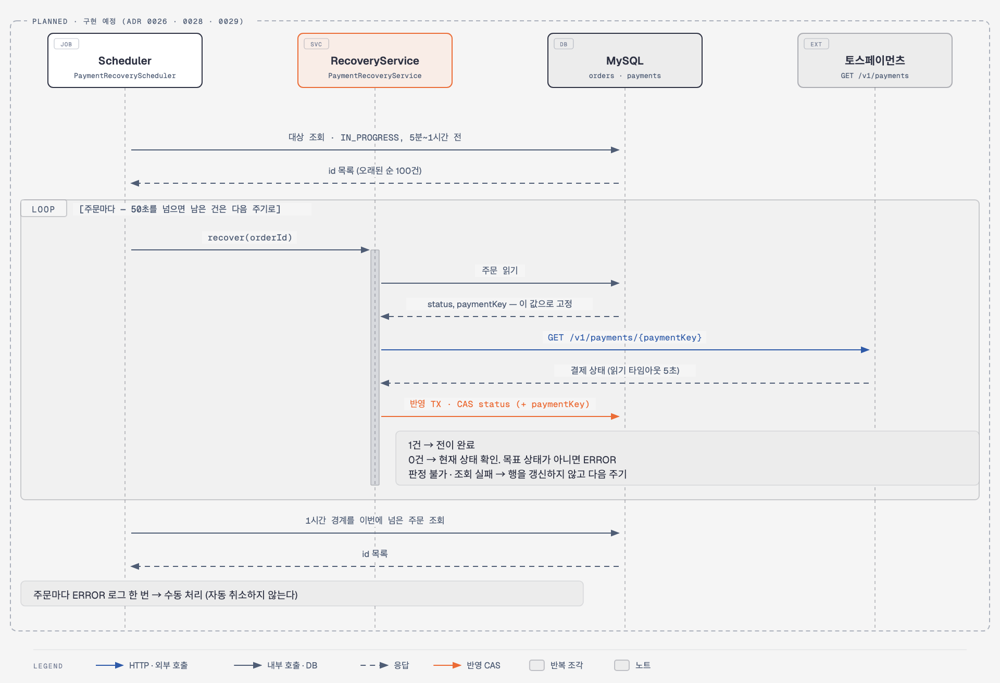
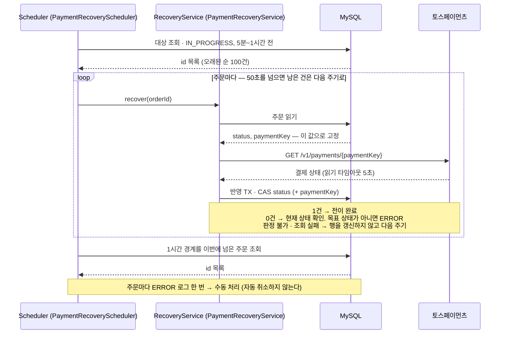

# 결제 복구 배치

> Payment는 아직 구현 전이다. 이 그림은 [ADR 0026](../../decisions/purchase/0026-payment-confirm-outside-transaction.md)·[0028](../../decisions/purchase/0028-payment-result-whitelist-and-recovery-limit.md)·[0029](../../decisions/purchase/0029-refund-outside-transaction.md)의 설계다.

- **답하는 질문**: 결과를 모른 채 멈춘 결제·환불 주문을 어떻게 토스 기준으로 바로잡고, 판정되지 않는 주문은 어떻게 넘기는가
- **범위**: `PaymentRecoveryScheduler` 한 번 실행. 판정 표는 [payment.md](../../domains/purchase/payment.md)의 "복구 배치"가 기준이다
- **원천**: [payment.md](../../domains/purchase/payment.md) · ADR [0026](../../decisions/purchase/0026-payment-confirm-outside-transaction.md) · [0028](../../decisions/purchase/0028-payment-result-whitelist-and-recovery-limit.md) · [0029](../../decisions/purchase/0029-refund-outside-transaction.md) · [0030](../../decisions/purchase/0030-recovery-batch-runtime-limits.md)

Mermaid 원본 — 내용은 이 블록이 기준이고 PNG는 여기서 다시 그린다

## 읽는 법

**대상 고르기**
- **판정 대상은 `updated_at`이 5분 넘게 지난 주문이다.** 1분은 실행 주기일 뿐이다. 요청은 최대 약 100초 안에 끝나므로, 살아 있는 요청과 배치가 같은 주문을 판정하지 않는다
- 1시간이 넘은 주문은 대상에서 뺀다. 판정되지 않는 주문이 오래된 순 조회의 앞을 막지 않게 하려는 것이다

**판정과 반영**
- **토스 조회는 트랜잭션 밖이다.** 조회가 느려도 커넥션과 행 락을 쥐지 않는다
- **반영은 요청 경로와 같은 CAS다.** 승인은 `status`와 `payment_key`를, 환불은 `status`를 비교한다. 요청과 배치, 여러 인스턴스가 겹쳐도 한쪽만 반영된다
- 처음 읽은 `paymentKey`를 그대로 CAS에 넘긴다. 그사이 거절 → 재시도로 키가 바뀌었으면 0건으로 끝난다
- 판정하지 못하면 행을 건드리지 않는다. `updated_at`이 바뀌면 1시간 종결 시계가 리셋된다

**종결**
- 1시간 경계를 막 넘은 주문만 ERROR 로그를 한 번 남긴다. 자동으로 취소하지 않는다. 돈이 빠져나갔을 수 있어서다
- 실행당 50초 예산은 다음 주문을 시작하기 전에만 확인한다. 넘으면 남은 건은 다음 주기로 넘어간다
