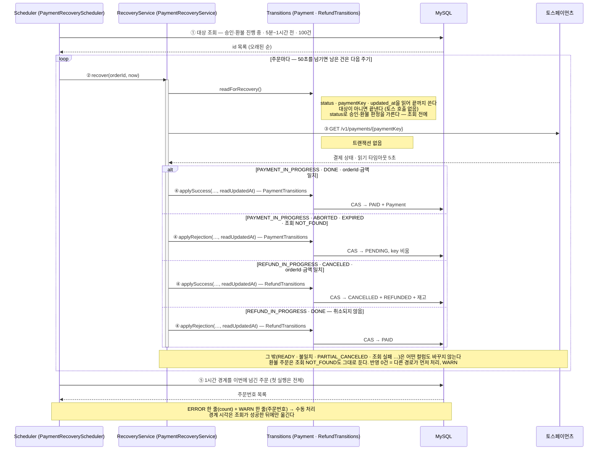

# 7. 결제 복구 배치

> **결과를 모른 채 멈춘 `PAYMENT_IN_PROGRESS` · `REFUND_IN_PROGRESS` 주문을 토스 조회로 판정한다. 판정하지 못하면 손대지 않고, 1시간이 넘으면 사람에게 넘긴다.**

| | |
|---|---|
| 답하는 질문 | 멈춘 승인·환불 주문을 어떻게 토스 기준으로 바로잡고, 판정되지 않는 주문은 어떻게 넘기는가 |
| 범위 | `PaymentRecoveryScheduler` 한 번 실행. 판정 표의 기준은 [payment.md](../../domains/purchase/payment.md)의 "복구 배치" |
| 근거 | ADR [0026](../../decisions/purchase/0026-payment-confirm-outside-transaction.md) · [0028](../../decisions/purchase/0028-payment-result-whitelist-and-recovery-limit.md) · [0029](../../decisions/purchase/0029-refund-outside-transaction.md) · [0030](../../decisions/purchase/0030-recovery-batch-runtime-limits.md) |

## 핵심 흐름

`@Scheduled` 1분 주기(`fixedDelay`), 인스턴스마다 돈다. 분산 락은 없고 반영 CAS가 경합을 막는다. 스케줄러 스레드 2개라 이 배치가 길어져도 15분 만료 배치는 멈추지 않는다.

| 그림 | 단계 | 핵심 |
|---|---|---|
| ① | 대상 조회 | `updated_at`이 **5분 ~ 1시간 전**인 두 상태를 오래된 순 100건 |
| ② | 주문마다 판정 | 새 읽기 TX로 `status` · `paymentKey` · `updated_at`을 읽어 끝까지 쓴다. 대상이 아니면 끝. **토스 조회 전에 상태로 승인·환불 판정을 가른다** |
| ③ | 토스 조회 | 트랜잭션 밖, 읽기 5초(승인·취소와 다른 클라이언트) |
| ④ | 반영 | 요청 경로와 같은 메서드에 **읽은 `updated_at`**을 넘긴다 |
| ⑤ | 1시간 경보 | 이번에 1시간 경계를 넘긴 주문만 ERROR 한 줄 + 주문번호 WARN 한 줄 |

**판정표** — 그림의 ALT 네 갈래

| 주문 상태 | 토스 조회 | 반영 |
|---|---|---|
| `PAYMENT_IN_PROGRESS` | `DONE` + 주문 일치 | `PAID` + `Payment(SUCCESS)` |
| `PAYMENT_IN_PROGRESS` | `ABORTED` · `EXPIRED` · `NOT_FOUND_PAYMENT` | `PENDING`, `paymentKey` 비움 |
| `REFUND_IN_PROGRESS` | `CANCELED` + 주문 일치 | `CANCELLED` + `REFUNDED` + 재고 복구 |
| `REFUND_IN_PROGRESS` | `DONE` | `PAID` — 취소되지 않았다 |

그 밖(`READY` · 불일치 · `PARTIAL_CANCELED` · 조회 실패 …)은 **어떤 컬럼도 바꾸지 않는다.** 환불 주문은 `NOT_FOUND_PAYMENT`도 그대로 둔다 — 결제가 있던 주문이라 우리 쪽 오류이기 때문이다. 조회 전에 상태로 가르는 이유가 이것이다.

## 지키는 것

| 불변식 | 깨지면 | 장치 |
|---|---|---|
| 살아 있는 요청과 겹치지 않는다 | 요청이 반영하기 직전에 배치가 판정 | 판정 시작 5분 > 요청 최대 수명 약 100초 (모든 구간에 타임아웃) |
| 옛 정보로 새 상태를 덮지 않는다 | 다른 인스턴스·사용자가 바꾼 상태가 옛 조회 결과로 뒤집힌다(ABA) | 반영 CAS가 읽은 `updated_at`까지 비교 |
| 판정하지 못한 주문은 건드리지 않는다 | `updated_at`이 바뀌어 1시간 시계가 리셋 | 판정 불가면 어떤 컬럼도 갱신하지 않음 |
| 결론이 안 나는 주문은 사람이 안다 | 돈과 주문이 어긋난 채 묻힌다 | 1시간 경보 (한 번만, 자동 취소 없음) |
| 한 배치가 다른 배치를 막지 않는다 | 토스 지연으로 만료 배치까지 멈춘다 | 스레드 2개 + 실행 예산 50초 |

- **5분 ~ 1시간인 이유** — 5분 전은 살아 있는 요청의 몫이고, 1시간이 넘은 주문은 오래된 순 조회의 앞줄을 계속 차지해 정상 복구를 밀어내므로 빼고 경보로 넘긴다
- **WARN인 이유** — 1분마다 같은 주문을 다시 보므로 ERROR면 1시간에 60번 찍힌다. 끝내 판정되지 않으면 1시간 경보가 ERROR로 한 번 알린다
- **자동 취소하지 않는 이유** — 돈이 빠져나갔을 수 있다. 운영자가 토스 개발자센터에서 `paymentKey`로 확인하고 처리한다

## 경로별 반영 조건

| | 승인 반영 | 환불 반영 |
|---|---|---|
| 요청 경로 | `status` + `payment_key` | `status` |
| 복구 배치 | `status` + `payment_key` + 읽은 `updated_at` | `status` + 읽은 `updated_at` |

요청 경로는 `readUpdatedAt`에 `null`을 넘겨 조건을 끈다. 모든 CAS가 `updated_at`을 새로 찍으므로, 상태가 같은 값으로 돌아와도 흔적이 남는다 — 스키마 변경 없이 기존 컬럼을 버전처럼 쓴다.

## 코드 위치

| 그림 | 코드 |
|---|---|
| 진입 | `PaymentRecoveryScheduler.run` (`@Scheduled`, `spring.task.scheduling.pool.size: 2`) |
| ① | `PaymentRecoveryService.findTargetIds` → `OrderRepository.findRecoveryTargetIds` |
| ② | `recoverStuckOrders` → `PaymentRecoveryService.recover` → `PaymentTransitions.readForRecovery` |
| ③ | `PaymentGateway.getPayment` → `TossPaymentGateway` (`tossLookupRestClient`) |
| ④ | `PaymentTransitions` · `RefundTransitions`의 `applySuccess` · `applyRejection` (`readUpdatedAt` 오버로드) |
| ⑤ | `PaymentRecoveryScheduler.alertAbandoned` → `OrderRepository.findAbandonedOrderNumbers` |
| 테스트 | `PaymentRecoveryTest` |

Mermaid 원본 — 내용은 이 블록이 기준이고 PNG는 여기서 다시 그린다

---

[← 이전: 6. 환불](seq-refund.md) · [목차](README.md)
