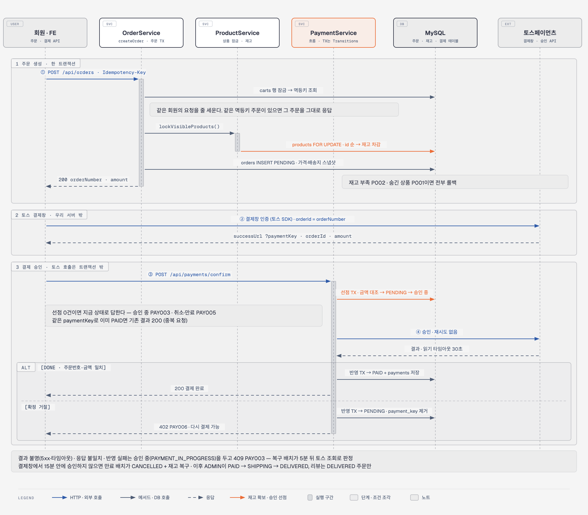

# 0. 주문 · 결제 전체 흐름

> **재고는 주문 생성에서 확보하고, 돈은 선점에 성공한 승인 한 번으로 확정한다.**

| | |
|---|---|
| 답하는 질문 | 재고는 언제 확보되고, 돈은 언제 확정되며, 중간에 끊기면 어떻게 되는가 |
| 범위 | `POST /api/orders` → 토스 결제창 → `POST /api/payments/confirm`. `PAID` 이후(배송·환불)는 다루지 않는다 |
| 근거 | [order.md](../../domains/purchase/order.md) · [payment.md](../../domains/purchase/payment.md) · ADR [0025](../../decisions/purchase/0025-pessimistic-lock-as-stock-concurrency-baseline.md) · [0026](../../decisions/purchase/0026-payment-confirm-outside-transaction.md) |

## 핵심 흐름

세 단계는 **하나의 트랜잭션이 아니라 독립된 세 번의 요청**이다. 흐름은 FE가 끌고 가고, 서버 쪽에서 셋을 잇는 것은 DB의 주문 행 하나뿐이다.

| 단계 | 하는 일 | 재고 · 돈 |
|---|---|---|
| 1 주문 생성 | 한 트랜잭션에서 `carts` → `products`(id 순) 잠금, 재고 차감, `PENDING` 저장 | 재고 확보 · 돈은 그대로 |
| 2 토스 결제창 | FE ↔ 토스 사이에서 인증만 받는다. 우리 서버는 관여하지 않는다 | 승인 전이라 돈은 미확정 |
| 3 결제 승인 | 선점 CAS로 한 요청만 토스를 부르고, 토스 호출은 트랜잭션 밖에서 한다 | 성공을 반영하면 돈 확정 |

세 단계를 잇는 값은 넷이다 — `orderNumber`(토스 `orderId`로도 쓴다), `status`(어디까지 왔나), `totalAmount`(승인 금액 대조 기준), `paymentKey`(선점한 시도 식별).

## 단계 사이에 끊기면

| 일어날 수 있는 일 | 막는 장치 |
|---|---|
| 주문만 만들고 결제창을 닫음 | 15분 만료 배치가 `CANCELLED` + 재고 복구 |
| 주문 생성 요청이 중복 전송됨 | `Idempotency-Key` + `carts` 락 + 복합 유니크 → 기존 주문 반환 |
| FE가 보낸 `amount`가 조작됨 | 선점 전에 DB 금액과 대조 → 토스 호출 없이 `PAY004` |
| 승인 요청이 중복 전송됨 | 선점 CAS로 한 요청만 진입, 나머지는 현재 상태로 응답 |
| 승인 도중 토스 응답이 사라짐 | `PAYMENT_IN_PROGRESS`로 남기고 복구 배치가 5분 뒤 판정 |

전체를 하나로 묶지 않고 **단계마다 커밋하고 진행 상황을 주문 상태에 기록**한다. 끊겨도 상태만 보면 어디서 멈췄는지 알 수 있고, 배치가 그 지점부터 마무리한다.

## 다음 그림

| 보고 싶은 것 | 그림 |
|---|---|
| 상태가 어떻게 움직이나 | [1. 주문 상태](state-order.md) |
| 1단계 세부 | [3. 주문 생성](seq-order-create.md) |
| 3단계 세부 | [4. 결제 승인](seq-payment-confirm.md) · [5. 결제 게이트웨이](payment-gateway.md) |
| `PAID` 이후 취소 | [6. 환불](seq-refund.md) |
| 끊긴 주문의 마무리 | [7. 결제 복구 배치](seq-payment-recovery.md) |

---

[목차](README.md) · [다음: 1. 주문 상태 →](state-order.md)
