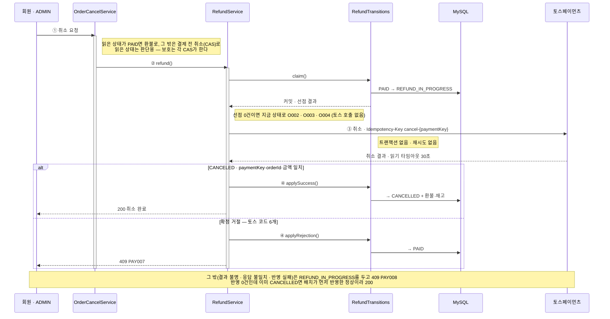

# 환불

> 이 그림은 Phase 4 · 12단계에서 구현한 **`PAID` 주문 취소(환불)** 다. 설계 근거는 [ADR 0029](../../decisions/purchase/0029-refund-outside-transaction.md)·[0030](../../decisions/purchase/0030-recovery-batch-runtime-limits.md), 구현 진행은 [roadmap.md](../../roadmap.md)가 소유한다.

- **답하는 질문**: 되돌릴 수 없는 토스 취소를 어떻게 한 번만 부르고, 돈이 돌아간 뒤에만 재고를 푸는가
- **범위**: 회원 취소(`POST /api/orders/{orderNumber}/cancel`)와 ADMIN 상태 변경(`CANCELLED`)이 `PAID` 주문을 만났을 때. 결제 전 취소는 [order.md](../../domains/purchase/order.md)
- **원천**: [payment.md](../../domains/purchase/payment.md)의 "환불" · `OrderCancelService` · `RefundService` · `RefundTransitions`

Mermaid 원본 — 내용은 이 블록이 기준이고 PNG는 여기서 다시 그린다

## 그림 따라 읽기

승인([seq-payment-confirm.md](seq-payment-confirm.md))과 같은 모양이다. 선점 TX → 토스 호출(트랜잭션 밖) → 반영 TX.

### ① 진입 — `OrderCancelService`

- 회원은 `cancelByMember(userId, orderNumber)`, ADMIN은 `cancelByAdmin(orderId)`로 들어온다. 규칙은 같고 토스에 보내는 취소 사유만 다르다("고객 요청" / "관리자 취소")
- 상태를 읽어 `PAID`면 `RefundService`로, 그 밖이면 기존 결제 전 취소(`OrderService.cancelPendingOrder`)로 보낸다. `PENDING`이 아니면 그쪽 CAS가 0건이 되고 상태별 코드로 거절된다
- **이 클래스에는 트랜잭션이 없다.** ADMIN의 `CANCELLED`를 `OrderService.changeOrderStatus`(트랜잭션 메서드)에서 처리하면 토스 취소가 트랜잭션 안에 들어간다. 그래서 컨트롤러가 `CANCELLED`만 따로 이리 보낸다

### ② 선점 — `RefundTransitions.claim()`

- CAS `PAID → REFUND_IN_PROGRESS`. 기존 `transitionStatus`를 그대로 쓴다
- 1건이 된 요청만 토스를 부른다. 동시 취소 두 건 중 하나, ADMIN 배송 처리(`PAID → SHIPPING`)와 환불 중 하나만 성공한다
- 0건이면 `OrderService.cancelRejection`이 지금 상태로 코드를 고른다

| 지금 상태 | 코드 |
|---|---|
| `PAYMENT_IN_PROGRESS`, `REFUND_IN_PROGRESS` | O003 |
| `SHIPPING`, `DELIVERED` | O002 |
| `CANCELLED` | O004 |

### ③ 토스 취소 — 트랜잭션 밖

- `PaymentGateway.cancel(paymentKey, reason)`. 전액 취소라 금액을 보내지 않는다
- 멱등키는 `cancel-{paymentKey}`다. 복구 배치가 `PAID`로 되돌린 뒤 다시 취소해도 같은 키가 나가, 앞선 취소가 실제로 처리 중이었다면 토스가 중복 취소를 막는다
- 자동 재시도하지 않는다. 결과를 모르면 배치가 조회로 판정한다

### ④ 반영

**성공 — `applySuccess()`**
- 응답이 `CANCELED`이고 `paymentKey` · `orderId` · 금액이 주문과 같을 때다
- 한 트랜잭션에서 CAS `REFUND_IN_PROGRESS → CANCELLED`, `Payment.refund(canceledAt)`, `OrderService.restoreStock`(상품 id 오름차순 잠금 후 복구)
- **재고는 여기서만 푼다.** 토스 취소가 확인되기 전에 풀면, 거절됐을 때 결제는 살아 있는데 재고가 팔려 나간다
- 환불 시각은 응답의 `cancels[].canceledAt`. 없으면 반영 시각으로 넣고 WARN

**확정 거절 — `applyRejection()`**
- 토스가 취소를 받아들이지 않았다고 확인된 6개 코드다(`REFUND_REJECTED` 등, ADR 0029)
- CAS `REFUND_IN_PROGRESS → PAID`. 사용자가 고칠 수 있는 원인이 아니라 ERROR로 남기고 `PAY007`로 답한다

### 그 밖 — 그림의 아래 노트

| 경우 | 처리 | 응답 |
|---|---|---|
| 결과 불명 (5xx · 타임아웃 · 경보 코드 · "이미 취소됨") | 상태 유지, WARN(경보 코드면 ERROR) | 409 PAY008 |
| 응답이 `CANCELED`가 아니거나 주문과 다름 | 상태 유지, ERROR | 409 PAY008 |
| 반영 중 예외 | 롤백, 상태 유지, ERROR. 돈은 돌아갔으니 실패로 답하지 않는다 | 409 PAY008 |
| 반영 0건, 지금 `CANCELLED` | 배치가 먼저 반영한 정상 | 200 |
| 반영 0건, 그 밖 | ERROR | 409 PAY008 |

`REFUND_IN_PROGRESS`로 남은 주문은 [복구 배치](seq-payment-recovery.md)가 5분 뒤부터 조회한다. `CANCELED`면 같은 `applySuccess`, `DONE`이면 `applyRejection`이다.

## 코드 위치

| 그림의 단계 | 메서드 |
|---|---|
| ① | `OrderController.cancelOrder` · `AdminOrderController.changeOrderStatus` → `OrderCancelService` |
| ② | `RefundService.refund` → `RefundTransitions.claim` → `OrderRepository.transitionStatus` |
| ③ | `PaymentGateway.cancel` → `TossPaymentGateway` (`tossRestClient`, 30초) |
| ④ | `RefundTransitions.applySuccess` · `applyRejection` → `OrderRepository.applyRefundResult` |
| 재고 | `OrderService.restoreStock` (`propagation = MANDATORY`) |
| 테스트 | `RefundServiceTest` 13건, `OrderControllerTest`의 환불 3건 |
