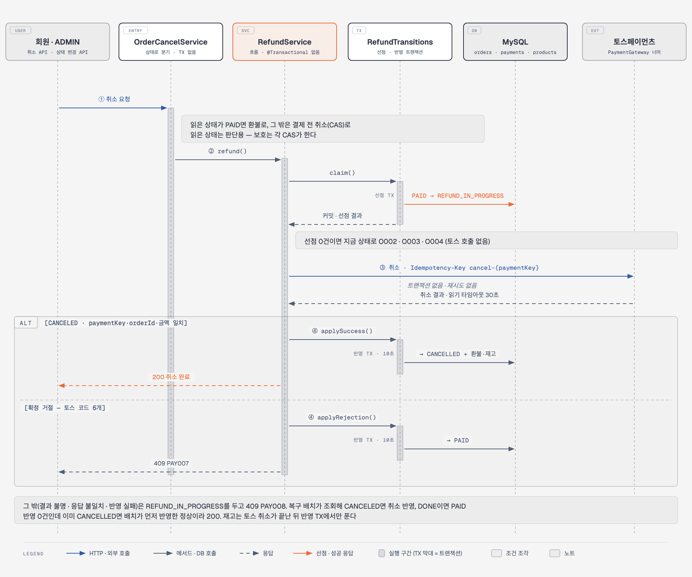
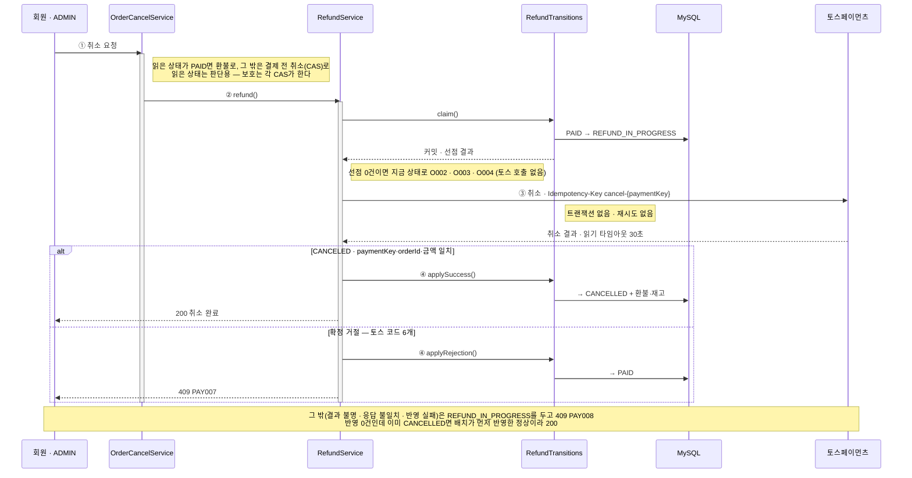

# 6. 환불

> **승인과 같은 모양(선점 TX → 토스 취소 → 반영 TX)이다. 되돌릴 수 없는 토스 취소를 먼저 하고, 재고는 돈이 돌아간 뒤에만 푼다.**

| | |
|---|---|
| 답하는 질문 | 되돌릴 수 없는 토스 취소를 어떻게 한 번만 부르고, 돈이 돌아간 뒤에만 재고를 푸는가 |
| 범위 | 회원 취소(`POST /api/orders/{orderNumber}/cancel`)와 ADMIN `CANCELLED`가 `PAID` 주문을 만났을 때. 결제 전 취소는 [order.md](../../domains/purchase/order.md) |
| 근거 | [payment.md](../../domains/purchase/payment.md)의 "환불" · ADR [0029](../../decisions/purchase/0029-refund-outside-transaction.md) · [0030](../../decisions/purchase/0030-recovery-batch-runtime-limits.md) |

## 핵심 흐름

| 그림 | 단계 | 핵심 |
|---|---|---|
| ① | 진입 — `OrderCancelService` | 회원·ADMIN이 같은 곳으로 모인다. 상태를 읽어 `PAID`면 환불, 그 밖은 결제 전 취소(`PENDING` CAS)로. **트랜잭션 없음** |
| ② | 선점 TX | CAS `PAID → REFUND_IN_PROGRESS`. 0건이면 지금 상태로 `O002` · `O003` · `O004` (토스 호출 없음) |
| ③ | 토스 취소 | 트랜잭션 밖, 전액 취소, `Idempotency-Key: cancel-{paymentKey}`, 재시도 없음 |
| ④ | 반영 TX | 성공 → `CANCELLED` + `Payment.refund` + 재고 복구를 한 트랜잭션으로 / 확정 거절(6개 코드) → `PAID` |

- **①에서 읽은 상태는 판단용이다.** 실제 보호는 각 경로의 CAS가 한다. `PAID`를 읽고 환불로 갔는데 그사이 배송이 먼저 됐다면 ②가 0건이 되어 `O002`로 끝난다
- **ADMIN의 `CANCELLED`만 컨트롤러에서 따로 보낸다.** `OrderService.changeOrderStatus`는 트랜잭션 메서드라, 거기서 환불하면 토스 취소가 트랜잭션 안에 들어간다
- **승인과 달리 응답의 `paymentKey`까지 비교한다.** 환불은 우리 DB에 저장된 키로 호출하므로 비교할 기준이 있다

## 지키는 것

| 불변식 | 깨지면 | 장치 |
|---|---|---|
| 토스 취소는 주문당 한 번만 | 중복 취소, 결과 혼선 | 선점 CAS + 멱등키 `cancel-{paymentKey}` |
| **돈이 돌아간 뒤에만 재고를 푼다** | 토스가 거절하면 결제는 살아 있는데 재고는 팔려 나간다 | 재고 복구는 반영 TX(토스 취소 성공 뒤)에만 |
| 돈이 돌아갔으면 결국 `CANCELLED` | 환불됐는데 `PAID`로 남아 배송된다 | 결과를 모르면 `REFUND_IN_PROGRESS` 유지 → 복구 배치 |
| 환불과 배송은 동시에 성립하지 않는다 | 환불한 주문이 출고된다 | 둘 다 `PAID`에 대한 CAS |

**순서의 원칙** — 되돌릴 수 없는 일(토스 취소)을 먼저, 되돌릴 수 있는 일(상태·재고)을 뒤에 한다. 상태와 재고를 먼저 바꾸면 거절 시 재고만 팔려 나가고, 한 트랜잭션으로 묶으면 커밋 실패 시 돈은 돌려줬는데 `PAID`가 남는다.

재고 복구(`restoreStock`)는 주문 생성과 **같은 순서(id 오름차순)로 잠근 뒤** 읽고, `MANDATORY`라 트랜잭션 밖에서는 부를 수 없다.

## 실패하면

| 상황 | 응답 | 주문 |
|---|---|---|
| 확정 거절 (6개 코드) | `PAY007` + ERROR (결제사 사유 확인 필요) | `PAID` |
| 결과 불명 (5xx · 타임아웃 · "이미 취소됨") | `PAY008` | `REFUND_IN_PROGRESS` 유지 → 배치 |
| 응답이 `CANCELED`가 아니거나 주문과 다름 | `PAY008` + ERROR | 유지 |
| 반영 중 예외 | `PAY008` — 돈은 돌아갔으니 실패로 답하지 않는다 | 롤백, 유지 |
| 반영 0건, 지금 `CANCELLED` | 200 — 배치가 먼저 반영한 정상 | `CANCELLED` |

"이미 취소됨"도 바로 성공으로 처리하지 않는다. 복구 배치가 조회로 `CANCELED`를 확인하고 같은 반영을 한다 — 판정 경로를 하나로 두기 위해서다.

**환불의 ABA** — 같은 결제를 다시 취소하므로 `paymentKey`가 매번 같아 키로는 시도를 구분할 수 없다. 요청 경로는 상태만으로 충분하고(선점한 요청만 반영, 수명 약 100초), 복구 배치는 **읽은 `updated_at`**까지 비교해 상태가 한 바퀴 돈 경우를 막는다(ADR 0030).

## 코드 위치

| 그림 | 코드 |
|---|---|
| ① | `OrderController.cancelOrder` · `AdminOrderController.changeOrderStatus` → `OrderCancelService` |
| ② | `RefundService.refund` → `RefundTransitions.claim` → `OrderRepository.transitionStatus` |
| ③ | `PaymentGateway.cancel` → `TossPaymentGateway` (`tossRestClient`, 30초) |
| ④ | `RefundTransitions.applySuccess` · `applyRejection` → `OrderRepository.applyRefundResult` |
| 재고 | `OrderService.restoreStock` (`propagation = MANDATORY`) |
| 테스트 | `RefundServiceTest` · `OrderControllerTest`의 환불 케이스 |

Mermaid 원본 — 내용은 이 블록이 기준이고 PNG는 여기서 다시 그린다

---

[← 이전: 5. 결제 게이트웨이](payment-gateway.md) · [목차](README.md) · [다음: 7. 결제 복구 배치 →](seq-payment-recovery.md)
