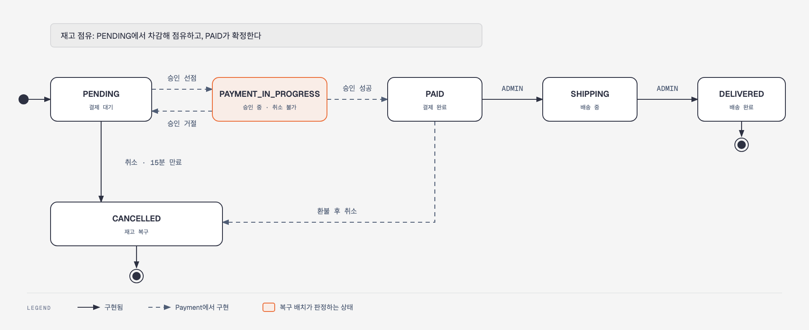
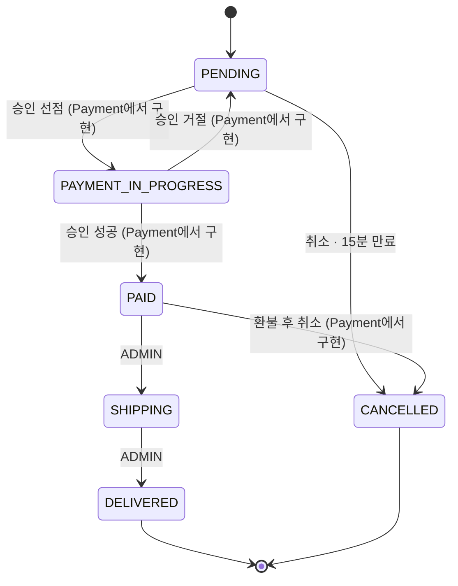

# 주문 상태

- **답하는 질문**: 주문은 어떤 상태를 거치고, 언제 재고를 점유·복구하는가
- **범위**: `OrderStatus` 전체. 허용 전이의 기준은 [order.md](../../domains/purchase/order.md)의 상태 전환표다
- **원천**: [order.md](../../domains/purchase/order.md) · [payment.md](../../domains/purchase/payment.md) · ADR [0016](../../decisions/purchase/0016-stock-reserved-at-order-not-cart.md) · [0026](../../decisions/purchase/0026-payment-confirm-outside-transaction.md)

Mermaid 원본 — 내용은 이 블록이 기준이고 PNG는 여기서 다시 그린다

## 읽는 법

- **재고는 `PENDING`에서 점유한다.** 주문 생성의 차감이 곧 점유이고, `CANCELLED`로 가는 모든 전이가 재고를 복구한다
- **`PAYMENT_IN_PROGRESS`는 취소할 수 없다.** 토스 승인과 어긋날 수 있어서다. 결과를 모르면 복구 배치가 토스를 조회해 판정한다
- 승인 거절로 돌아온 `PENDING`은 만료 시간이 다시 시작되어, 사용자가 다른 카드로 재시도할 수 있다
- 점선은 Payment에서 구현한다. 지금 `PAID` 취소는 `O002`로 거절한다
