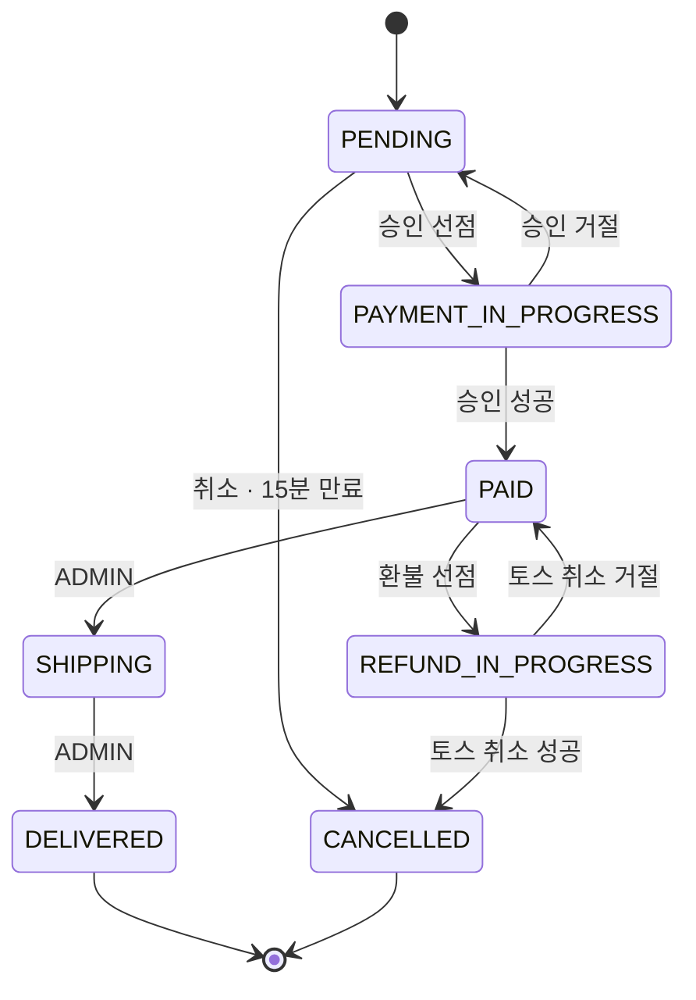

# 1. 주문 상태

> **모든 전이는 CAS 하나이고, 주황색 두 상태(토스 호출 중)에서는 취소·만료·배송이 막힌다.**

| | |
|---|---|
| 답하는 질문 | 주문은 어떤 상태를 거치고, 언제 재고를 점유·복구하는가 |
| 범위 | `OrderStatus` 7개 전체. 허용 전이의 기준은 [order.md](../../domains/purchase/order.md)의 상태 전환표 |
| 근거 | [order.md](../../domains/purchase/order.md) · [payment.md](../../domains/purchase/payment.md) · ADR [0016](../../decisions/purchase/0016-stock-reserved-at-order-not-cart.md) · [0026](../../decisions/purchase/0026-payment-confirm-outside-transaction.md) · [0029](../../decisions/purchase/0029-refund-outside-transaction.md) |

## 핵심 흐름

`DELIVERED`와 `CANCELLED`가 최종 상태다. **아래 표에 없는 전이는 모두 거절한다.**

| 현재 → 다음 | 누가 | CAS (`OrderRepository`) |
|---|---|---|
| `PENDING` → `PAYMENT_IN_PROGRESS` | 승인 요청 (선점) | `claimPayment` |
| `PAYMENT_IN_PROGRESS` → `PAID` / `PENDING` | 승인 성공 / 확정 거절, 또는 복구 배치 | `applyPaymentSuccess` / `applyPaymentRejection` |
| `PENDING` → `CANCELLED` | 회원·ADMIN 취소 / 15분 만료 배치 | `transitionStatus` / `cancelExpiredPendingOrder` |
| `PAID` → `SHIPPING` → `DELIVERED` | ADMIN | `transitionStatus` |
| `PAID` → `REFUND_IN_PROGRESS` | 회원·ADMIN 취소 (환불 선점) | `transitionStatus` |
| `REFUND_IN_PROGRESS` → `CANCELLED` / `PAID` | 토스 취소 성공 / 확정 거절, 또는 복구 배치 | `applyRefundResult` |

점선은 **토스 호출이 끼는 전이**다. 이 여섯 개만 복구 배치가 함께 노린다.

## 지키는 것

| 규칙 | 이유 |
|---|---|
| 재고는 `PENDING`에서 점유하고, `CANCELLED`로 가는 세 경로에서만 복구한다 | 결제 진행 중에는 취소도 만료도 안 되므로 결과가 확정될 때까지 재고가 묶여 있다 |
| `*_IN_PROGRESS` 동안 취소·만료·배송 불가 | 토스 호출 결과와 우리 상태가 엇갈리지 않게 한다. 멈추면 복구 배치가 판정한다 |
| 같은 전이를 요청과 배치가 같은 CAS로 노린다 | 한쪽만 1건, 진 쪽은 0건이다. 0건은 정상 흐름이다 |
| 환불 선점과 배송 처리는 둘 다 `PAID`에 대한 CAS | 동시에 들어와도 둘 중 하나만 성공한다 |
| 재고는 토스 취소가 끝난 뒤에 푼다 | 먼저 풀면, 환불이 거절됐을 때 팔린 재고를 되찾을 수 없다 |

승인 거절로 돌아온 `PENDING`은 `updated_at`이 갱신되어 15분 만료 시계가 다시 시작된다. 같은 주문으로 다른 카드를 써서 재시도할 수 있다.

## 코드 위치

| 요소 | 코드 |
|---|---|
| 상태 | `OrderStatus` |
| 전이 CAS | `OrderRepository` — 위 표의 메서드 |
| 재고 복구 | `OrderService.restoreStock` (`propagation = MANDATORY`) |

Mermaid 원본 — 내용은 이 블록이 기준이고 PNG는 여기서 다시 그린다

---

[← 이전: 0. 전체 흐름](seq-purchase-overview.md) · [목차](README.md) · [다음: 2. 장바구니 담기 →](seq-cart-add.md)
