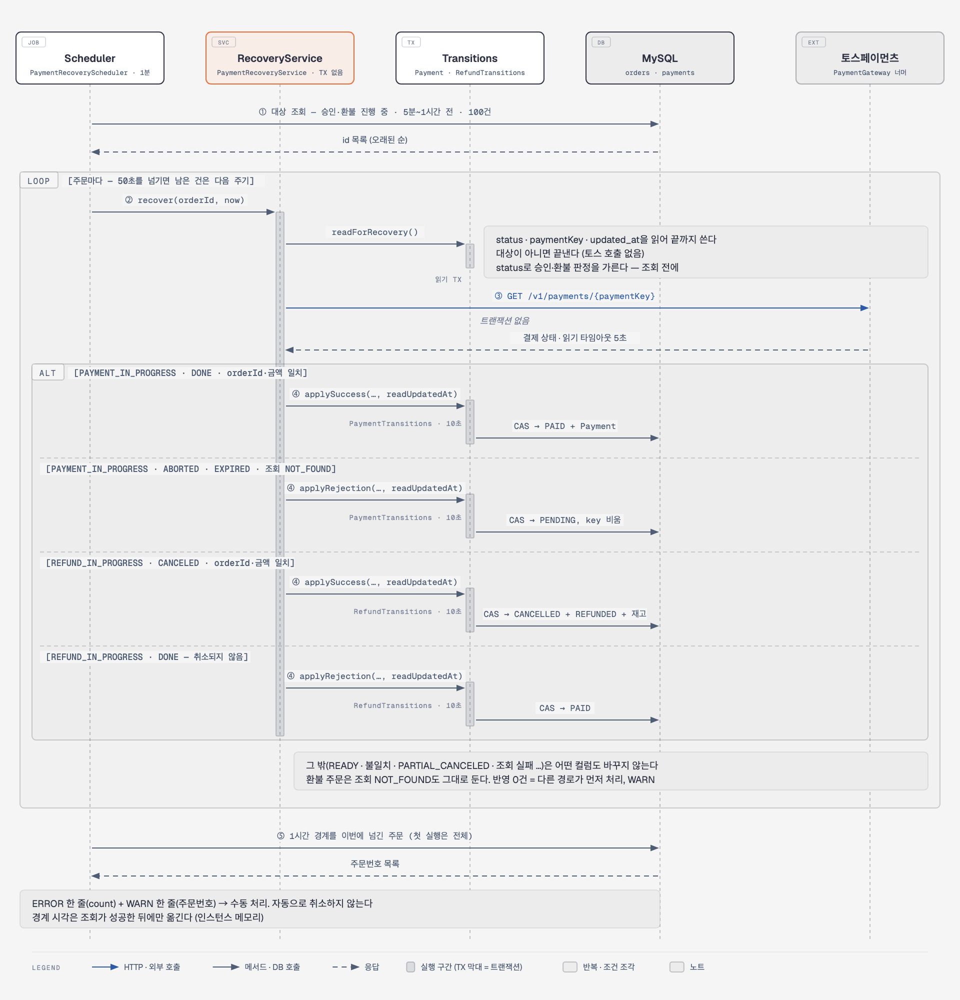

# payment — 결제

> 이 문서는 **구현할 계약**이고, 진행 현황은 [roadmap.md](../../roadmap.md)가 소유한다.
> 엔티티, 토스 연동 경계(`PaymentGateway`), 승인 API가 코드에 있다. 조회 API, 환불, 복구 배치는 아직 없다.

[order.md](order.md)의 주문 하나에 결제 하나가 붙는다. 셋에 걸친 엔티티 관계는 [README.md](README.md)가 소유한다.

## 한눈에 보기

| 항목 | 정한 것 |
|---|---|
| PG | **토스페이먼츠 주문서형(결제위젯)**. 카드 입력·인증은 토스 결제창 안에서 끝나 카드 데이터가 백엔드를 지나지 않는다 |
| 역할 분담 | FE가 결제창을 띄우고, 백엔드는 **승인과 결과 반영**을 맡는다 |
| 범위 | 1 주문 : 1 결제, 전액 결제·전액 환불만. **가상계좌는 초기 범위 밖** — 입금까지 일 단위라 입금 대기 상태와 수단별 만료가 따로 필요하다 |
| 핵심 원칙 | 토스 호출은 되돌릴 수 없어 **트랜잭션 밖**에서 하고, 결과를 모르면 되돌리지 않고 **복구 배치**가 토스에 물어 판정한다 |

| 흐름 | 절 | 근거 |
|---|---|---|
| 승인 | [API → 결제 승인](#post-apipaymentsconfirm--결제-승인) | [ADR 0026](../../decisions/purchase/0026-payment-confirm-outside-transaction.md) · [0028](../../decisions/purchase/0028-payment-result-whitelist-and-recovery-limit.md) |
| 환불 | [환불](#환불) | [ADR 0029](../../decisions/purchase/0029-refund-outside-transaction.md) |
| 복구 | [복구 배치](#복구-배치) | [ADR 0028](../../decisions/purchase/0028-payment-result-whitelist-and-recovery-limit.md) · [0030](../../decisions/purchase/0030-recovery-batch-runtime-limits.md) |
| 토스 호출 | [토스 연동](#토스-연동) | [ADR 0028](../../decisions/purchase/0028-payment-result-whitelist-and-recovery-limit.md) · [0029](../../decisions/purchase/0029-refund-outside-transaction.md) |

## 결제 전체 흐름

```
FE     POST /api/orders                    → { orderNumber, amount }
FE     토스 SDK 결제창 호출                  orderId = orderNumber, amount, successUrl, failUrl
토스   인증 성공 → successUrl (FE 페이지)    ?paymentKey&orderId&amount
FE     POST /api/auth/refresh              새로 로드된 페이지라 액세스 토큰부터 복구
FE     POST /api/payments/confirm          승인과 결과 반영
토스   인증 실패·취소 → failUrl (FE 페이지)  백엔드 호출 없음
```

- **successUrl·failUrl은 FE 페이지다.** 액세스 토큰이 `Authorization` 헤더로만 실려 토스의 리다이렉트는 인증되지 않는다. 백엔드 엔드포인트를 리다이렉트 대상으로 두지 않는다
- **successUrl 페이지는 먼저 세션을 복구한다.** 페이지가 새로 로드되어 메모리의 액세스 토큰이 없으므로, [auth.md](../auth.md) FE 계약대로 `POST /api/auth/refresh`를 부른 뒤 승인을 호출한다
- **토스 `orderId`는 `Order.orderNumber`다.** 토스 `orderId`는 6자 이상이고, PK를 쓰면 주문 순번이 노출된다
- **failUrl은 주문을 바꾸지 않는다.** 결제창을 닫은 경우도 포함하므로 즉시 취소하면 재시도할 수 없다. 주문은 `PENDING`, 재고는 점유된 채 같은 주문으로 다시 시도한다.
  끝내 결제되지 않은 주문은 [order.md](order.md)의 `PENDING` 만료 처리가 정리한다

## 엔티티

id, order, paymentKey, amount, method, status(SUCCESS/REFUNDED), paidAt, refundedAt

| 필드 | 규칙 |
|---|---|
| `order` | unique. **1 Order : 1 Payment**를 DB가 강제한다. 부분·분할 결제는 열지 않는다 |
| `paymentKey` | 토스가 발급하는 결제 식별자. 조회·취소의 키라 저장하고 unique로 둔다 |
| `amount` | `DECIMAL(14,2)`. `Order.totalAmount`와 자릿수를 맞춘다 |
| `method` | 토스 문자열 그대로(`"카드"`, `"간편결제"` 등). 새 수단이 와도 반영이 실패하지 않게 enum으로 두지 않는다 |
| `paidAt` · `refundedAt` | 토스 `approvedAt` · `cancels[].canceledAt`을 서버 시간대로 옮겨 저장한다. 오프셋을 떼지 않는다 |

**승인에 성공한 결제만 저장한다.** 거절을 행으로 남기면 그 주문의 재시도가 `order` unique에 막힌다. 거절은 로그로 남긴다.

## API

| Method | URI | 설명 | 권한 |
|---|---|---|---|
| POST | `/api/payments/confirm` | 결제 승인 | 회원 |
| GET | `/api/payments/{orderNumber}` | 결제 정보 조회 | 회원 |

### POST `/api/payments/confirm` — 결제 승인

FE가 successUrl에서 받은 `{ paymentKey, orderId, amount }`로 호출한다. 토스 승인을 **한 번만** 호출하고 그 결과를 주문에 반영한다.

```
선점 트랜잭션
  1. orderNumber로 주문 조회, 소유자 검증            → 없거나 타인의 주문 O001
  2. amount == Order.totalAmount 확인                → 다르면 PAY004, 토스 호출 없음
  3. CAS PENDING → PAYMENT_IN_PROGRESS + paymentKey 저장
     └ 0건이면 현재 상태로 분기 (아래 "중복 요청")
커밋

토스 승인 API 호출 (트랜잭션 없음, 자동 재시도 없음)

반영 트랜잭션 (paymentKey까지 비교하는 CAS)
  성공        PAID + Payment(SUCCESS) 저장
  확정 거절    PENDING + paymentKey 비움, 거절 로그
  결과 불명    변경 없음 → 복구 배치가 판정
커밋
```

**결과별 응답**

| 결과 | 응답 | 이유 |
|---|---|---|
| 성공 (`orderId`·금액 일치) | 200 결제 정보 | |
| 금액 불일치 | `PAY004` | `amount`는 리다이렉트 쿼리라 사용자가 고칠 수 있다. 토스를 부르지 않는다 |
| 확정 거절 (한도 초과, 카드사 거절 등) | `PAY006` | 재고는 점유된 채 남고 사용자는 **결제창부터** 다시 시도한다 |
| 결과 불명 (타임아웃, 응답 유실 등) | `PAY003` 승인 진행 중 | 토스에서 승인됐을 수 있어 되돌리지 않는다 |

**중복 요청** — 3번 CAS가 0건일 때

| 현재 상태 | 응답 |
|---|---|
| `PAYMENT_IN_PROGRESS` | `PAY003` 승인 진행 중 |
| `PAID` + 같은 `paymentKey` | 기존 결제 반환 — 응답을 잃은 FE의 재시도다 |
| `PAID` + 다른 `paymentKey` | `PAY002 PAYMENT_ALREADY_EXISTS` |
| 그 밖의 상태 | `PAY005` 승인 불가 |

**0건 뒤의 재확인은 새 트랜잭션에서 한다.** 선점·반영 CAS가 0건이면 현재 상태를 다시 읽는데, MySQL 기본 격리 수준(REPEATABLE READ)에서는
같은 트랜잭션 안의 재조회가 처음 읽은 시점의 스냅샷을 돌려줘 다른 쪽이 커밋한 상태를 놓친다.

**반영 쪽 예외 처리**

| 상황 | 응답 | 처리 |
|---|---|---|
| 성공 반영 0건, 다른 경로가 같은 키로 `PAID` 반영 | 기존 결제 반환 | 정상 |
| 성공 반영 0건, 그 밖 | `PAY003` | ERROR — 토스는 승인했으니 실패로 답하지 않는다([ADR 0030](../../decisions/purchase/0030-recovery-batch-runtime-limits.md)) |
| 성공 반영 트랜잭션 실패 (DB 예외·타임아웃 10초) | `PAY003` | ERROR, 상태 유지 → 복구 배치가 `PAID`로 전진 |
| 승인 응답의 `orderId`·금액이 주문과 다름, 또는 `DONE`이 아님 | `PAY003` | ERROR, 전이하지 않음([ADR 0028](../../decisions/purchase/0028-payment-result-whitelist-and-recovery-limit.md) 응답 검증) |
| 거절 반영 0건·실패 | `PAY006` | 토스 거절은 확정이라 응답은 그대로. 상태가 `PENDING`이 아니면 ERROR |

**응답 형식** — 승인 성공, 같은 키의 재요청, 결제 조회가 같다. 결제 PK와 `paymentKey`는 내보내지 않고 결제는 `orderNumber`로 가리킨다.

```json
{ "orderNumber": "ORD-20261106-A1B2C3D4E5F6", "amount": 128000, "method": "카드", "status": "SUCCESS", "paidAt": "2026-11-06T10:15:30" }
```

### GET `/api/payments/{orderNumber}` — 결제 정보 조회

```
1. 주문 조회, 소유자 검증            → 없거나 타인의 주문 O001
2. 그 주문의 결제 조회               → 없으면 PAY001
3. 응답 변환
```

성공한 결제만 저장하므로 승인 전이거나 거절된 주문은 `PAY001`이다.

## 환불

API가 따로 없다. 회원의 주문 취소(`POST /api/orders/{orderNumber}/cancel`)와 ADMIN의 상태 변경이 `PAID` 주문이면 이 흐름을 탄다.

```
선점 트랜잭션
  CAS PAID → REFUND_IN_PROGRESS              → 0건이면 상태로 거절 (O002 · O003 · O004)
커밋

토스 결제 취소 호출 (트랜잭션 없음)          PaymentGateway.cancel — 전액 취소

반영 트랜잭션
  성공         CANCELLED + Payment(REFUNDED) + products 잠금 (id 오름차순) 후 재고 복구
  확정 거절    CAS → PAID, ERROR 로그          → 409 PAY007
  결과 불명    변경 없음 → 복구 배치가 판정     → 409 PAY008
커밋
```

- **토스 취소가 끝난 뒤에 재고를 푼다.** 토스 취소는 되돌릴 수 없어 트랜잭션 밖에서 부르고, 돈이 돌아간 뒤에 재고를 복구한다
- 환불은 `PAID`인 주문만, 전액만 한다. `SHIPPING` 이후는 반품이라 범위 밖이다
- 토스 취소 요청 중(`REFUND_IN_PROGRESS`)인 주문은 다시 취소하거나 배송 처리할 수 없다
- 환불 시각은 응답의 `cancels[].canceledAt`이다

## 복구 배치

API가 아니라 스케줄 작업이다. 서버 장애나 응답 유실로 요청이 끝내지 못한 주문(`PAYMENT_IN_PROGRESS`·`REFUND_IN_PROGRESS`)을 **토스 조회 결과로 바로잡는다.**

### 구조

```
PaymentRecoveryScheduler      @Scheduled 1분, 트랜잭션 없음
  ├─ recoverStuckOrders()     5분~1시간 멈춘 주문 판정, 실행당 50초 예산
  │    └─ PaymentRecoveryService.recover(id)        주문마다, 트랜잭션 없음
  │         ├─ 주문 읽기 (status, paymentKey, updated_at 고정)
  │         ├─ 토스 조회 (트랜잭션 밖, 읽기 타임아웃 5초)
  │         └─ ApprovalTransactions / RefundTransactions   요청 경로와 같은 CAS + 읽은 updated_at
  └─ alertAbandoned()         이번에 1시간을 막 넘긴 주문만 한 번 ERROR
```



읽는 법과 Mermaid 원본: [seq-payment-recovery.md](../../diagrams/purchase/seq-payment-recovery.md).

### 판정

**`PAYMENT_IN_PROGRESS` 주문** — 승인 반영과 같은 CAS (`status` + `payment_key` + 읽은 `updated_at`)

| 토스 조회 결과 | 처리 |
|---|---|
| `DONE` + `orderId`·금액 일치 | `PAID` + `Payment(SUCCESS)` 저장 |
| `DONE` + 불일치 | 변경 없음, WARN. 1시간 뒤 수동 처리 |
| `ABORTED`, `EXPIRED`, `NOT_FOUND_PAYMENT` | `PENDING` + `paymentKey` 비움 |
| `READY`, `IN_PROGRESS`, 조회 실패 | 변경 없음, 다음 주기에 다시 조회 |
| `CANCELED` 계열, `WAITING_FOR_DEPOSIT` | 변경 없음, WARN. 1시간 뒤 수동 처리 |

**`REFUND_IN_PROGRESS` 주문** — 환불 반영과 같은 CAS (`status` + 읽은 `updated_at`)

| 토스 조회 결과 | 처리 |
|---|---|
| `CANCELED` | `CANCELLED` + `Payment(REFUNDED)` + 재고 복구 |
| `DONE` | `PAID` 복귀. 취소되지 않았다 |
| `PARTIAL_CANCELED`, 그 밖 | 변경 없음, WARN. 1시간 뒤 수동 처리 |
| 조회 실패 | 변경 없음, 다음 주기에 다시 조회 |

### 규칙

| 규칙 | 지키지 않으면 |
|---|---|
| **반영은 요청 경로와 같은 메서드를 쓰고, 읽을 때 본 `updated_at`을 조건에 더한다** | 요청·배치·여러 인스턴스가 겹칠 때, 다른 인스턴스가 `PAID`로 되돌린 뒤 사용자가 다시 취소한 새 환불 시도를 옛 조회 결과로 되돌린다 |
| **조회에 쓴 `paymentKey`를 그대로 CAS에 넘긴다** | 그사이 거절 → 재시도로 바뀐 키에 이전 결과가 반영된다 |
| **판정하지 못하면 행을 갱신하지 않는다** | `updated_at`이 바뀌어 1시간 종결 시계가 리셋되고, 수동 처리로 넘어가지 않는다 |
| **배치의 반영 CAS가 0건이면 WARN으로 끝낸다** | 다른 경로가 먼저 처리한 정상 경우에 오경보가 난다. 그 주문은 바뀐 `updated_at` 때문에 다음 주기 대상에서도 빠진다 |
| 요청 경로의 반영이 0건이면 현재 상태를 확인해, 목표 상태가 아니면 ERROR | 토스와 주문이 어긋난 것을 아무도 모른다 |

**1시간 경보는 한 번만 낸다.** 직전 실행 이후 1시간 경계를 넘은 주문만 ERROR로 남기고, 매 주기 반복하지 않는다. 인스턴스가 여러 대면 중복될 수 있다.

- 기동 후 첫 실행은 1시간 넘은 주문 **전체**를 경보한다. 서버가 내려가 있는 동안 경계를 넘은 주문이 빠지지 않게 한다
- 기준 시각은 경보 조회가 성공한 뒤에만 갱신한다
- 대상이 많으면 건수 ERROR 한 줄과 주문 목록 WARN으로 나눈다. 형태는 구현 단계에서 정한다

**수동 처리:** 자동으로 취소하지 않는다. 돈이 빠져나갔을 수 있어서다. 운영자가 토스 개발자센터에서 `paymentKey`로 상태를 확인한다.
승인됐으면 `PAID`와 `Payment`를 DB에 반영하고, 승인되지 않았으면 `PENDING`으로 되돌리고 `paymentKey`를 비운다.

### 수치

| 항목 | 값 | 이유 |
|---|---|---|
| 실행 주기 | 1분 (`fixedDelay`) | 앞 실행이 끝난 뒤 센다. 한 인스턴스 안에서는 겹치지 않는다 |
| 판정 대상 | `updated_at`이 5분 ~ 1시간 전 | 5분은 요청 최대 수명보다 길어야 한다. 1시간이 넘으면 수동 처리 |
| 한 번에 | 100건, 오래된 순 | `idx_orders_status_updated_at`을 탄다 |
| 실행 예산 | 50초 | 다음 주문을 시작하기 전에만 확인하고, 넘으면 남은 건은 다음 주기로 넘긴다 |
| 토스 조회 타임아웃 | 읽기 5초 | 조회는 실패해도 다음 주기에 다시 하면 된다. 승인·취소의 30초와 별개다 |
| 반영 트랜잭션 타임아웃 | 10초 | 요청 최대 수명에 상한을 둔다 |
| 스케줄러 스레드 | 2 (`spring.task.scheduling.pool.size`) | 기본값 1이면 복구 배치가 길어질 때 `PENDING` 만료 배치까지 멈춘다 |

| 계산 | 값 | 내역 |
|---|---|---|
| 복구 한 건의 상한 | 약 18초, 커넥션 풀 고갈 시 약 78초 | 토스 조회(연결 3 + 읽기 5) + 반영 10. 고갈 시 주문 읽기·반영의 커넥션 대기 30 × 2가 더해진다 |
| 실행 한 번의 상한 | 50초 + 한 건 | 처리 중인 주문은 끊지 않는다 |
| 요청 최대 수명 | 약 100초 | 커넥션 대기 30 × 2(선점·반영) + 토스 호출(연결 3 + 읽기 30) + 반영 10. 판정 시간 5분보다 짧다 |

- 수명이 바뀌면 판정 시간 5분도 함께 다시 계산한다
- 테스트 키로 잰 조회 응답은 0.2~0.3초라 5초에 여유가 있다. 50초 예산과 배치 크기는 상점 키·운영 측정으로 다시 본다

## 토스 연동

### 왜 게이트웨이를 두나

토스를 부르는 곳은 승인 API, 복구 배치, 환불 세 군데다. 각자 토스를 직접 부르면 인증 헤더, 멱등키, 에러 코드 해석이 세 곳에 흩어지고
한 곳만 틀려도 그 경로만 다르게 동작한다. 그래서 **토스와의 통신을 `PaymentGateway` 한 곳에 모은다.**

구조와 응답 판정 흐름은 [결제 게이트웨이 다이어그램](../../diagrams/purchase/payment-gateway.md)이 그림으로 보여준다.

| 얻는 것 | 내용 |
|---|---|
| 판정이 한 곳 | **"확실히 안 됐다"와 "모른다"의 구분**을 게이트웨이만 한다. 이 구분이 틀리면 결제된 주문을 되돌려 중복 청구가 날 수 있다(ADR 0028) |
| 흐름이 읽힌다 | 서비스에는 성공 / 확정 거절 / 결과 불명 세 갈래만 남아 ADR 0026의 선점 → 호출 → 반영이 그대로 보인다 |
| 테스트 | 서비스 테스트는 `FakePaymentGateway`로 "거절", "타임아웃" 같은 상황을 토스 없이 만든다 |

```
PaymentService · PaymentRecoveryService · RefundService
        │  confirm / getPayment / cancel
        ▼
PaymentGateway          ← 서비스는 이 인터페이스와 예외 두 개만 안다
        │
        ▼
TossPaymentGateway      ← 인증, 멱등키, 요청·응답 변환, 실패 분류
        │  HTTPS
        ▼
토스페이먼츠 API
```

### `PaymentGateway` 계약

```java
public interface PaymentGateway {
    TossPayment confirm(String paymentKey, String orderId, BigDecimal amount);
    TossPayment getPayment(String paymentKey);
    TossPayment cancel(String paymentKey, String cancelReason);
}
```

성공하면 `TossPayment`를 돌려주고, 실패하면 **반드시 둘 중 하나**를 던진다.

| 예외 | 뜻 | 호출자의 처리 |
|---|---|---|
| `PaymentRejectedException` | 토스가 처리하지 않았다고 **확인됨**. 결제·취소는 일어나지 않았다 | 상태를 되돌린다 |
| `PaymentResultUnknownException` | 처리됐는지 **모름** | 상태를 유지하고 복구 배치에 맡긴다. `alert`면 경보 대상 |

게이트웨이는 토스와 한 번 통신하고 결과를 해석하는 데까지만 책임진다. **주문 상태 변경, 저장, 재시도는 하지 않는다.**

### `TossPaymentGateway` 설계

**요청을 만든다**

| 메서드 | 토스 API | 게이트웨이가 채우는 것 |
|---|---|---|
| `confirm` | `POST /v1/payments/confirm` | `Idempotency-Key: {paymentKey}`, `{ paymentKey, orderId, amount }`. 금액은 정수로 보내고, 원화에 소수가 있으면 토스를 부르지 않고 실패시킨다 |
| `getPayment` | `GET /v1/payments/{paymentKey}` | 읽기 타임아웃 5초짜리 클라이언트를 쓴다 |
| `cancel` | `POST /v1/payments/{paymentKey}/cancel` | `Idempotency-Key: cancel-{paymentKey}`, `{ cancelReason }`. `cancelAmount`가 없으면 전액 취소다 |

- 인증은 모든 요청에 `Authorization: Basic base64(시크릿키 + ":")`를 붙인다
- **멱등키는 게이트웨이가 만든다.** 서비스는 키 규칙을 모른다. 에러 뒤 키를 바꿔 재시도하지 않는다
- 토스 `orderId`는 `Order.orderNumber`다

**응답을 `TossPayment`로 바꾼다** — 토스 Payment 객체 중 쓰는 필드만 담는다.

| 토스 필드 | 용도 | 저장 |
|---|---|---|
| `paymentKey` | 결제 식별 | `payments.payment_key` |
| `orderId` | 다른 주문의 결제인지 검증 | 저장하지 않음. `orderNumber`와 대조 |
| `status` | 승인·취소 판정. 모르는 값은 `UNKNOWN`으로 받아 판정에서 "그 밖"으로 처리 | `DONE`이면 `Payment(SUCCESS)` |
| `totalAmount` | 금액 검증. `BigDecimal`로 받아 `compareTo`로 비교 | `payments.amount` |
| `method` | 결제 수단 | `payments.method` |
| `approvedAt` | 승인 시각 | `payments.paid_at` |
| `cancels[].canceledAt` | 환불 시각 | `payments.refunded_at` |

`TossPayment.matches(orderNumber, amount)`가 `orderId`와 금액을 함께 대조한다. 승인 성공과 조회 `DONE`은 이 검증을 통과해야 `PAID`가 된다.

**실패를 분류한다** — 실패 응답은 `{ code, message }`다.

| 응답 | 결과 |
|---|---|
| 4xx + 그 호출의 **확정 거절 목록**에 있는 코드 | `PaymentRejectedException` |
| 4xx + 목록에 없는 코드 | `PaymentResultUnknownException` |
| **5xx** (코드와 무관) | `PaymentResultUnknownException` — 서버 쪽에서 처리됐을 수 있다 |
| 타임아웃, 연결 실패, 해석할 수 없는 응답, 빈 body | `PaymentResultUnknownException` (코드 없음) |

| 호출 | 확정 거절 | 결과 불명 + 경보 |
|---|---|---|
| 승인 | 31개 — 카드·계좌 거절, 한도, 할부·수단, 세션 없음([ADR 0028](../../decisions/purchase/0028-payment-result-whitelist-and-recovery-limit.md)) | ADR 0028의 9개 + `DUPLICATED_ORDER_ID` |
| 취소 | 6개 — `REFUND_REJECTED` 등([ADR 0029](../../decisions/purchase/0029-refund-outside-transaction.md)) | 15개 — 설정 오류, 가상계좌·부분 취소 코드 |
| 조회 | `NOT_FOUND_PAYMENT` — 복구 배치가 거절로 반영한다 | 없음 |

- **목록에 없는 코드는 결과 불명이다.** 토스가 코드를 추가해도 안전한 쪽으로 처리된다
- 같은 코드도 호출마다 뜻이 다르다. 예: `NOT_FOUND_PAYMENT`는 승인·조회에선 거절, 취소에선 경보
- **경보 대상은 `alert`로 표시만 한다.** 로그 레벨은 호출 경로가 정한다 — 요청 경로는 ERROR, 복구 판정 중에는 WARN([ADR 0030](../../decisions/purchase/0030-recovery-batch-runtime-limits.md))
- `DUPLICATED_ORDER_ID`는 ADR 0028 작성 뒤 테스트 키로 확인한 코드다. 나오면 한 주문에 승인이 두 번 시도된 것이라 CAS가 깨졌다는 신호다

**HTTP 설정**

| 클라이언트 | 쓰는 곳 | 연결 | 읽기 |
|---|---|---|---|
| `tossRestClient` | 승인 · 취소 | 3초 | 30초 — 돈이 움직여 짧게 끊으면 결과 불명이 는다 |
| `tossLookupRestClient` | 조회 (복구 배치) | 3초 | 5초 — 한 건이 배치를 오래 붙잡지 않게 한다 |

- 시크릿 키는 `.env` 또는 환경변수 `TOSS_SECRET_KEY`로만 받는다(`toss.secret-key`). 없어도 기동은 되고, 토스 호출이 `UNAUTHORIZED_KEY` 경보로 실패한다
- **연동 제품은 주문서형이다.** 키는 `test_gck`/`test_gsk` 세트이고 FE 클라이언트 키와 같은 세트여야 한다. 섞으면 `INVALID_API_KEY`가 난다
- `orderId`로는 결제를 조회할 수 없어 복구는 저장한 `paymentKey`로 한다
- 승인은 결제창 인증 후 10분 안에 호출해야 한다

**테스트** — `TossPaymentGatewayTest`가 실제 토스 대신 응답을 흉내 내 분류를 검증한다. 서비스 테스트는 `FakePaymentGateway`로 결과를 정해 쓴다.

### 테스트 키 확인 결과

2026-11-11, 토스 문서용 주문서형 테스트 키(`test_gck_docs_…`/`test_gsk_docs_…`)로 확인했다. **실서비스 전에 상점 키로 다시 확인한다.**

| 확인 | 결과 | 의미 |
|---|---|---|
| 주문서형 키로 `paymentKey` 조회 | 된다 | 복구 배치가 성립한다 |
| 주문서형 키로 전액 취소 | 된다. `balanceAmount` 0, `cancels[].canceledAt` 있음 | 환불이 성립한다 |
| 전액 취소 후 조회 | `CANCELED` | ADR 0029 복구 판정과 맞다 |
| 승인되지 않은 시도가 남은 `orderId`로 다시 인증·승인 | 된다. `paymentKey`는 새로 발급된다 | `orderNumber`를 토스 `orderId`로 그대로 쓸 수 있다 |
| 다른 시도가 이미 승인된 `orderId`의 옛 시도를 승인 | `DUPLICATED_ORDER_ID` | 토스도 한 주문번호에 승인을 두 번 내주지 않는다 |
| 같은 `paymentKey`·같은 멱등키로 승인·취소 재호출 | 첫 응답을 그대로 돌려준다 | 멱등키가 승인에도 동작한다. 중복 방어는 계속 CAS가 맡는다 |
| 멱등키 없이 재호출 | `ALREADY_PROCESSED_PAYMENT` · `ALREADY_CANCELED_PAYMENT` | 결과 불명 분류가 맞다 |
| 주문과 다른 금액으로 승인 | `FORBIDDEN_REQUEST`, 결제는 `IN_PROGRESS`로 남음 | 승인 전 금액 대조(`PAY004`)로 이 호출을 하지 않는다 |
| 응답 시간 | 조회 0.2~0.3초, 승인 0.9초, 취소 1.3초 | 조회 타임아웃 5초, 승인·취소 30초에 여유가 있다 |
| `method` | `"간편결제"` | `VARCHAR(30)`에 들어간다 |

## 에러 코드

`PAY001`~`PAY006`은 `PaymentErrorCode`에 있다. `PAY007`·`PAY008`은 12단계에서 `PaymentErrorCode`와 [error-codes.md](../../conventions/error-codes.md)에 추가한다.

| 코드 | 상수 | HTTP | 언제 |
|---|---|---|---|
| PAY003 | `PAYMENT_IN_PROGRESS` | 409 | 승인 진행 중, 결과 불명 |
| PAY004 | `PAYMENT_AMOUNT_MISMATCH` | 400 | 요청 금액이 주문 금액과 다름 |
| PAY005 | `PAYMENT_NOT_ALLOWED` | 409 | 승인할 수 없는 주문 상태 |
| PAY006 | `PAYMENT_REJECTED` | 402 | 토스의 승인 거절 |
| PAY007 | `PAYMENT_REFUND_REJECTED` | 409 | 토스의 환불 거절 |
| PAY008 | `PAYMENT_REFUND_IN_PROGRESS` | 409 | 환불 결과 불명 |
